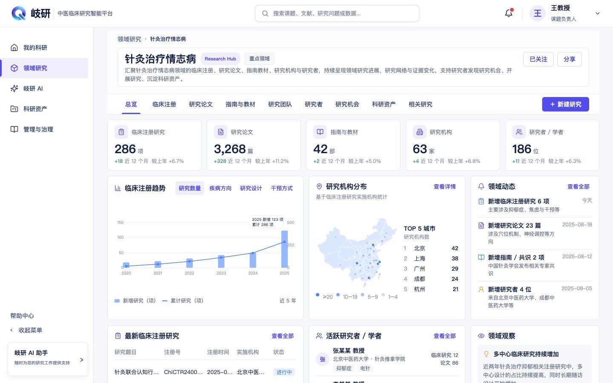
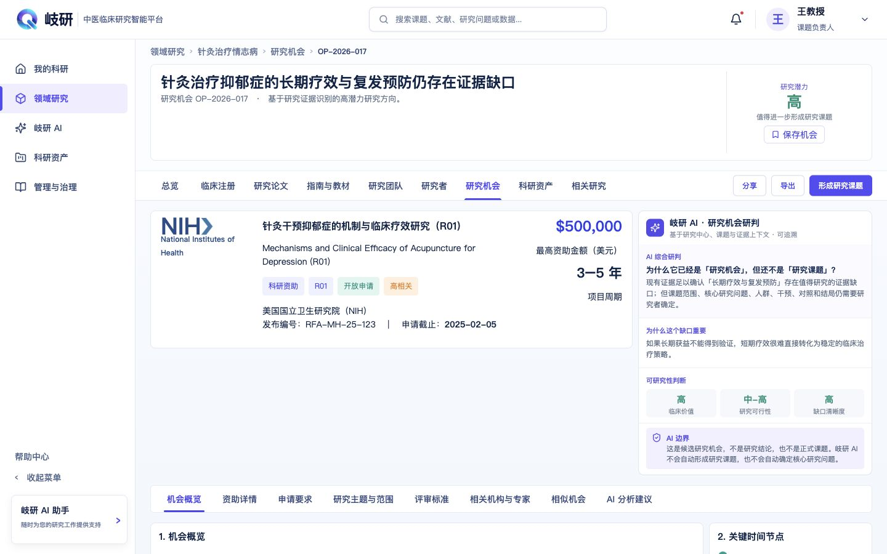
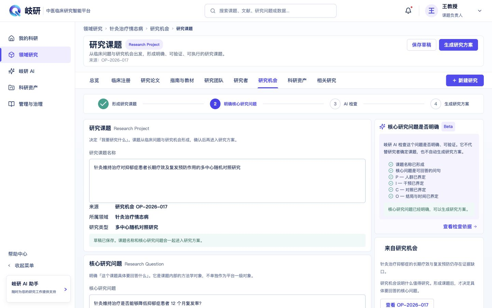
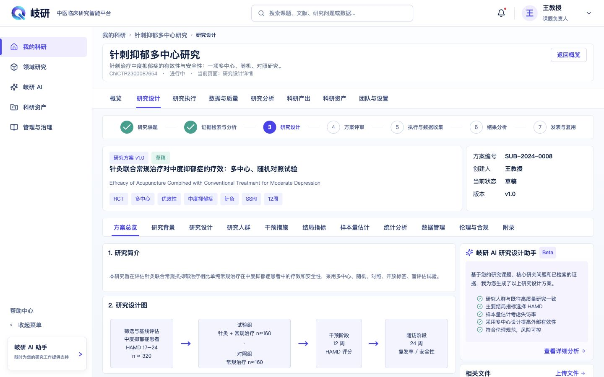
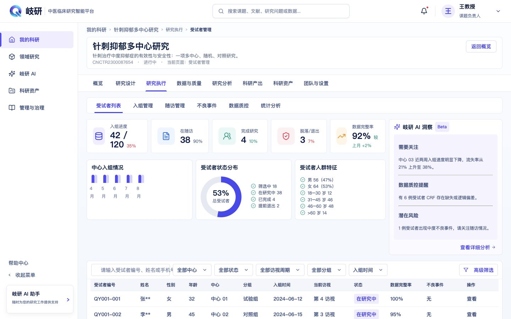
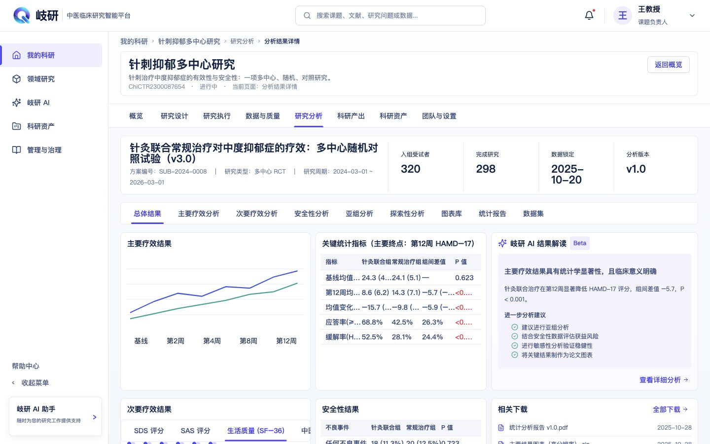
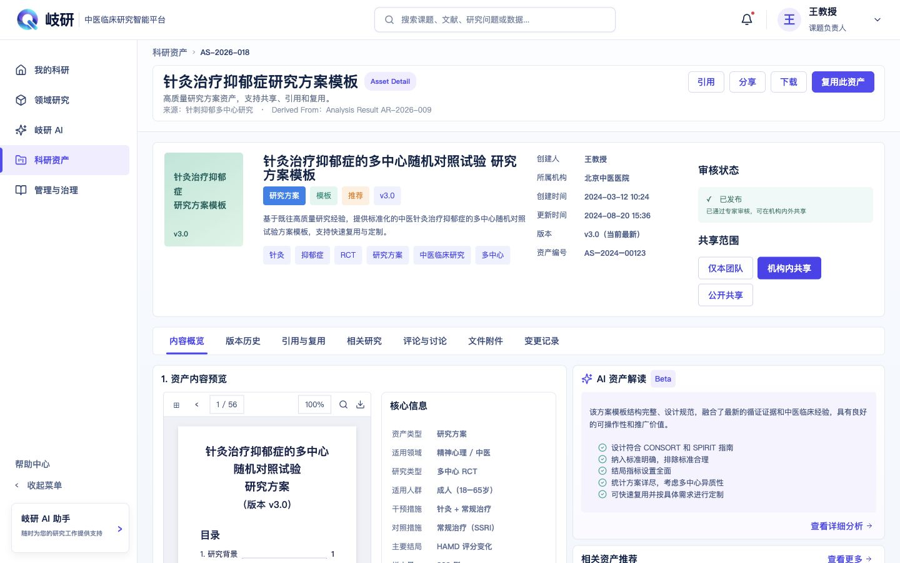

# 灵枢心域页面链路与功能补缺方案 V1.0

日期：2026-10-14。代码基准：`integrated-platform`，本次浏览器检查地址：`http://127.0.0.1:4174`，视口：1440×900。

当前共有32个登记页面，入口文件均存在。已有页面覆盖科研旅程的主要展示节点，但尚不能完成真实用户进入、课题持久化、对象上下文传递、研究产出沉淀与资产复用。本方案以修复闭环为优先级，不把缺少独立页面等同缺少功能，也不把可点击的静态页面视为业务已完成。

本轮完成现有页面串联验证和补缺设计，不新增业务页面、不接入真实认证或后端。每个建议都在现有React/Vite工程中实施，复用公共Shell与既有视觉；需要新增业务范围的条目另行确认。

## 1 审查方法与证据边界

- 核对32个登记入口、公共路由、Shell上下文映射、页面内链接规则与状态处理源码。
- 实际点击验证：P01→H01→O01→O02→Q01→S02→S03→S06→A01→A02；P002点击登录；S06点击科研产出；A02点击复用。8个关键状态截图保存并逐一查看。
- 源码依据：`platform-pages.json`、`src/platform-navigation.js`、`src/platform-shell.js`、`src/page-linking.js`、`src/platform-user.js`、`pages/shared/Q01Page.jsx`、`pages/p00/src/main.jsx`、`pages/p002/app.js`。
- 此次不是全量业务测试；表单所有组合、数据权限、真实后端、浏览器读屏与完整移动端流程尚未验证。文档中的“缺失”是当前前端交付范围内未发现对应闭环，不能推断其他服务仓库也没有实现。

## 2 当前页面如何串联

```text
公共门户
P00 通用首页 / P002 灵枢心域首页
  └ 登录与注册：原型反馈（真实账号进入链路缺失）

现有科研工作区展示链路
P01 我的科研
  ├ H05 领域目录 → H02 → H03 → H04 创建Hub（本机草稿）
  └ H01 领域总览
      ├ C01 临床注册 → C03 试验详情
      ├ E01 研究论文 → E02 论文详情；E03 AI证据页面
      ├ T01 团队列表 → T02 团队详情
      ├ R01 研究者 → R02 研究者详情
      └ O01 研究机会 → O02 机会详情 → Q01 形成课题
          → S02 研究设计 → S01 课题概览
          → S03 受试者管理 → S04 受试者详情
          → S05 数据质量 → S06 分析结果
          → 科研产出（缺失闭环）
          → A01 科研资产 → A02 资产详情 → 复用（缺失闭环）

横向能力
AI01 AI工作台：部分能力跳到已有页面，真实AI任务链待接入
G02 管理治理 → G01 审查审批：审批与其他治理能力待补
```

线条表示页面关系，不表示后端业务已实现。全局跳转目前主要只传页面编号；同一详情页展示固定示例，缺少Hub、机会、课题、方案、受试者、资产标识。T/R列表详情关系依据源码与现有产品基线，此次未逐条点击验证所有对象。

## 3 八步实际验证

| 步骤 | 操作与当前状态 | 结论 |
| --- | --- | --- |
| 1 门户进入 | P002点击登录，只显示说明；P00源码中的登录直接进入P01 | 账号入口未闭环，演示用户不是真实身份 |
| 2 领域入口 | P01点击领域研究进入H01，显示9个上下文入口 | 入口正常；指南教材、相关研究只有事件占位 |
| 3 研究机会 | H01→O01→查看机会详情→O02 | 页面可达，固定机会示例未传ID |
| 4 形成课题 | O02→Q01→保存草稿，出现保存成功文字 | Q01仅setSaved(true)，无持久化；保存反馈与实际能力不一致 |
| 5 研究方案 | Q01→生成研究方案→S02 | 可跳转，但Q01维持治疗课题变成S02固定联合治疗方案，业务内容没有继承 |
| 6 研究执行 | S02上下文导航→S03 | 受试者列表可见；执行被简化为受试者管理，任务与数据录入闭环不足 |
| 7 分析与产出 | S03→S06→点击科研产出 | 仍停留S06，缺产出管理与沉淀入口 |
| 8 资产复用 | S06→A01→详情A02→复用此资产 | 仍停留A02，未出现复用流程；源码为未消费事件占位 |

### 步骤1 门户进入


说明文案明确当前为原型，避免误以为已登录；需补账号流程和入口回跳。截图可见标题、关闭按钮和下一步入口，但本轮未做完整键盘焦点与读屏测试。

### 步骤2 领域入口



领域导航与五个一级工作空间区分清楚。未接入的标签仍可点击且没有页面反馈，容易让用户误以为操作失效；需明确状态并补对应能力。

### 步骤3 研究机会



形成课题主操作清晰；机会ID在文字中可见，但未作为跳转上下文传递。固定来源与后续课题缺少可验证关联。

### 步骤4 形成课题



保存后显示成功，实际仅更新内存标记；应以持久化结果反馈。表单需补错误摘要、输入标签关联、首次创建与已有草稿恢复状态。

### 步骤5 研究方案



详情结构完整，读者可理解方案组成；其名称和内容未继承上一页课题，不能作为新课题的生成结果验收。

### 步骤6 研究执行



统计与列表提供执行态势。任务、访视填写与CRF保存不能仅以这张列表替代；多行对象需要独立标识，不能全部进入同一示例详情。

### 步骤7 分析与产出



结果展示已有基础，但科研产出入口无业务变化。应接入已确认分析结果、产出版本和资产发布，不以截图图表作为已计算结果。

### 步骤8 资产复用



引用、分享、下载与复用按钮可见；复用无后续流程。应明确将资产用于哪个课题或方案、哪些内容复制、来源如何保留以及用户是否有权限。

## 4 缺口分为四类

| 类型 | 典型问题 | 补法 |
| --- | --- | --- |
| 页面确实不存在 | 登录、注册、帮助文章、科研产出、课题列表 | 新增唯一页面编号并登记入口 |
| 已有页面缺业务操作 | Q01草稿、S02编辑、A02复用、G01审批 | 在原页或抽屉补流程和服务，不重复造详情页 |
| 已有入口缺连接与上下文 | 无targetPage的标签、页面间不携带ID | 补集中路由、上下文契约、返回与错误恢复 |
| UI存在但缺数据与权限 | 固定演示用户、固定示例数据、导出下载占位 | 接口、会话、授权、对象状态与持久化联调 |

不能按“缺多少HTML文件”估算完成度。新页面数量需在设计时合并；复用、上传、搜索、通知可以使用抽屉或面板，无需每项增加独立页面。

## 5 按优先级补缺

P0指上线与核心流程阻断；P1指科研闭环必须完成；P2指外围增强或待确认扩展。以下编号均为**拟定编号**，实施前再次检查冲突，不冒充已经登记的路由。

| 优先级 | 功能/界面 | 现状 | 建议入口和实施方式 | 可验收结果 |
| --- | --- | --- | --- | --- |
| P0 | 登录、注册、找回密码 | 页面不存在，默认演示身份 | P003登录、P004注册、P005找回；P00/P002共用，真实接口 | 身份验证成功后回到合法原目标，登出与过期可恢复 |
| P0 | 学术资料与身份 | 顶栏用户菜单事件无消费 | P006首次完善资料；既有顶栏接用户菜单 | 个人身份与团队角色分离，管理角色不可自选 |
| P0 | 统一对象上下文 | goToPage仅页面编号 | 扩展集中导航与数据适配层 | Q01→S02保留课题、PICO与来源，不改变研究对象 |
| P0 | 持久化与真实反馈 | Q01假保存，其他模块多为示例 | Q01/S02等原页接保存、恢复、失败与版本冲突 | 保存后刷新和跨页可恢复，失败不显示成功 |
| P0 | 学术发起与帮助 | P002锚点替代页面，Shell帮助事件无消费 | P007学术发起、P008帮助、P009文章；公共布局 | 各入口到正确页面，帮助内容对应可用功能 |
| P1 | 我的课题列表 | P01只有摘要与固定课题入口 | Q02课题列表，来源于我的科研，不升级为一级导航 | 筛选、状态、打开正确课题、新建或草稿继续 |
| P1 | 方案编辑与版本 | S02主要是固定详情 | 原S02切换查看/编辑，必要时S07编辑页 | 保存结构化方案、版本差异、专家确认、审批关联 |
| P1 | 任务与进度 | 执行入口直接落受试者管理 | S08执行任务视图，与S03并列在执行上下文 | 负责人、期限、状态变更、中心进度与提醒 |
| P1 | 访视与数据录入 | S03/S04为列表和详情示例 | S04内访视/CRF编辑流程，复杂时S09数据采集页 | 保存校验、查询与修改、权限和修改记录 |
| P1 | 质控与分析任务 | S05/S06主要展示 | S05接质疑处理；S06接数据版本与分析任务状态 | 处理问题→数据确认→分析运行→结果确认可追溯 |
| P1 | 科研产出 | Study标签无目标 | S10科研产出，接S06的确认结果 | 报告、图表、文稿可关联版本，专家确认后沉淀资产 |
| P1 | 资产上传、引用与复用 | A01/A02事件占位 | A01上传抽屉；A02复用向导与权限申请 | 指定目标课题/方案，保留血缘、版本和访问范围 |
| P1 | 课题团队与设置 | Study标签无目标 | S11团队与设置，与领域公开团队T01区别 | 成员邀请、角色、中心职责、退出与权限回收 |
| P1 | 审查审批 | G01详情有UI，操作链待接入 | G01补待办列表、意见、补充与状态处理 | 授权角色审核，回到对应方案版本并留记录 |
| P1 | 指南教材与相关研究 | Hub标签无目标 | H06指南教材；H07相关课题列表，复用现有详情 | 内容来源可核对，按当前Hub筛选而非全局示例 |
| P1 | 全局搜索、通知、用户菜单 | 仅派发事件 | 在公共Topbar接搜索/通知面板，不另画顶栏 | 查找对象并带ID打开；任务通知回到对应操作 |
| P2 | 更多治理能力 | G02标签多无目标 | 分批补数据治理、研究质量、用户权限、多中心、审计、系统配置 | 先做当前首版实际需要的成员/权限/审计，其余确认范围 |
| P2 | 学术合作申请 | 尚在门户设计方案中 | P007的申请抽屉及管理员处理入口 | 有负责人和处理状态，未接服务不显示已提交 |
| P2 | AI写作与多任务能力 | AI_NAV多为占位，输出多示例 | AI01补任务类型、证据引用、失败/取消/确认 | 每次AI任务绑定对象与输入版本，专家可确认输出 |

安全、隐私和认证属于实现契约要求；不在此审查中判断项目已符合具体法律或临床标准。受试者数据采集与处理的正式要求由项目对应规范及业务负责人确认。

## 6 对已有链接的具体修复清单

1. `src/platform-navigation.js`：扩展 `goToPage(pageId, context)`，集中生成与校验站内路径，保留返回目标与对象ID。
2. `src/platform-shell.js`：Hub、Study、Governance导航的空target登记为明确待接入能力；实现后填真实目标，当前选中tab需有页内处理而非无反馈。
3. `src/page-linking.js`：更新与当前母版不匹配的历史选择器；按对象行传ID。校验Q01页头主操作是否执行与表单底部同一校验，避免绕过未完成字段。
4. P002门户：账号页面上线后统一替换登录/注册入口；演示意向与账号注册保持语义分离；领域探索可接H05/H01，不能让“进入平台”永远打开意向草稿。
5. P00门户：将直接进入P01的“登录”改成真实登录流程；预约仅sessionStorage保存时，修正文案“我们安排讲解”的承诺。
6. Q01→S02：确认课题后创建/打开对应方案，传递真实projectId/protocolId；成功反馈取决于服务结果。
7. Study/Hub→A01：保留范围过滤，面包屑和资产来源不能变成错误的全局上下文。
8. A02→复用：选择目标、检测权限、确认复制、完成后打开目标，并保留来源资产与版本。
9. C02：目前仅是跳转C01地图的历史别名，未登记构建入口；不算缺失业务页，建议移除导航依赖或保留明确重定向规则。

路由上下文建议：hubId、opportunityId、projectId、protocolId、subjectId、assetId、sourceVersion、returnTo。URL只带必要标识，不带密码、验证码或受试者敏感字段。跨页筛选状态可按对象与页面保存；不能用固定示例覆盖路由指定对象。

## 7 推荐实施批次与完成条件

| 批次 | 工作内容 | 前置依赖 | 完成条件 |
| --- | --- | --- | --- |
| M0 连接基础 | 路由矩阵、对象上下文、未实现入口反馈、示例模式标识 | 当前审查与统一代码基准 | 同一研究对象能跨页打开和返回；不会误报保存/提交成功 |
| M1 用户与门户 | 登录注册、资料、学术发起、帮助中心、会话适配 | 账号方式、协议文本、公开资料与认证接口确认 | 门户→用户→科研空间流程可完成，身份与权限明确 |
| M2 课题与方案 | 课题列表、Q01持久化、S02编辑版本、G01审批 | 项目/方案/审批接口契约 | 创建课题→方案→专家确认/审批→执行，刷新状态保留 |
| M3 执行与数据 | 任务、团队、访视采集、质控、分析任务 | 成员角色、数据采集和分析服务 | 问题能指派、数据能处理、分析结果绑定输入版本 |
| M4 成果与复用 | 科研产出、资产发布、引用、权限与复用 | 产出/资产服务、访问策略 | 本次研究成果可进入下一课题并保留来源 |
| M5 辅助与治理 | 指南、相关研究、搜索通知、扩展治理与AI任务 | 内容源、运营与新增范围确认 | 高频入口可用，低频扩展按已确认范围验收 |

这些批次是交付顺序，不是工期承诺；后端是否存在、角色和数据源确认后再估算人日。首个可评审演示应完成M0并选取一条M2主链，以同一个课题验证字段、保存和跳转；真实上线同时要求M1。

## 8 统一验收用例

- 账号：未登录进入受限对象→登录→返回同一对象；过期和无权限不是空白页。
- 科研闭环：从Hub机会创建课题，保存后刷新；确认PICO进入对应方案；专家确认后进入执行。
- 数据闭环：新增访视记录→校验失败修正→保存→质控查询→回应→记录状态更新。
- 产出闭环：确认分析版本→生成/上传产出→专家确认→发布科研资产→按权限复用到另一课题。
- 链接：列表各行打开各自对象，返回恢复筛选；错误ID、删除对象和缺权限有明确状态。
- 反馈：上传、保存、导出、提交、审批必须显示处理中/成功/失败；重复操作与网络中断可恢复。
- 界面：不改变五个一级工作空间；门户与工作区视觉各自一致；键盘可达、焦点可见、标签和错误可理解。

## 9 范围与待决策事项

原附件涵盖用户体系、科研执行、证据资产、协作、AI等范围，但未逐项规定本表的页面数量与服务细节。邮箱/短信、团队审核、合作申请、AI写作、在线客服或完整系统配置不能自动视为合同新增承诺。

需业务确认：首版验证渠道；团队/机构权限与审核；方案及资产版本策略；允许采集的数据范围；实际AI与分析服务；公开专家机构资料；帮助维护人；门户域名与P00/P002入口关系。待定项应记录负责人、决策结果与验收依据。

现有路由清单与可点击串联地图见配套《页面串联地图》，用于逐页评审。该地图是内部审查材料，不替代产品导航，也不模拟缺失页面上线。
