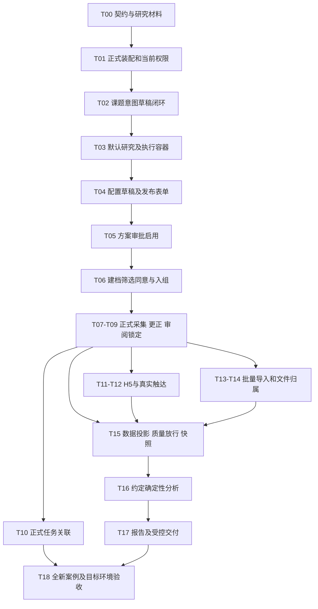

## 2026-11-13 · 科研课题流程19项验收完成

用户已对更正后最终Word报告明确回复“核对通过”。T00–T18共19项的代码、目标本机配置、真实执行与通用合成业务验收全部完成；[业务验收原件](../../testing/evidence/research-t18-2026-11-12/corrected-report-6277b638/business-acceptance.json)绑定同一报告和文件摘要。真实临床规则、专业签认与生产验收仍独立未验。以下技术阶段的“待用户反馈”属于验收前历史，当前状态以本段及机器台账为准。

## 2026-11-13 · T18 同一研究更正后报告技术闭环

19任务的T00–T17本机通用合成软件已通过；T18同例更正后分析与报告已获用户明确业务确认，本机通用合成流程四层完成。以[机器台账](continuous-status.json)及[同例验收](../../testing/research-study-workflow-2026-11-12.md)为准；以下早期拟定与中间待办是历史规划，不代替当前结果。

## 2026-11-12 最新验收定位

T00–T17当前本机通用合成软件四层通过，最近T17见[验收](../../testing/research-t17-2026-11-12.md)；主三渠道已实际完成采集/快照/Methods与人工确认。T18主同例报告/更正失效链及用户业务核对继续。机器台账与新增证据为准，下文早期拟新增/待实施仅为历史规划，临床/生产独立未验。

# ResearchHub 科研课题流程 Implementation Plan

> **For agentic workers:** REQUIRED SUB-SKILL: Use superpowers:subagent-driven-development (recommended) or superpowers:executing-plans to implement this plan task-by-task. 用户后续已明确“添加完后开始代码层面的执行”。最新用户授权按本清单T00–T18连续实施，完成一项直接推进下一项。已有T00–T03创建子集及本机证据按当前代码核验，余项逐项补齐；具体进度见[连续实施台账](continuous-execution.md)。真实临床启用、专业签收与生产发布仍须各自举证。

**Goal:** 最大复用旧系统，沿 ResearchHub 现有页面完成可创建、可采集、可审阅、可分析和可交付的一项研究。

**Architecture:** 旧 NestJS Service/事务核心、公共表与确定性算子继续承担业务执行；Hub 独立受控装配、产品课题/Study 映射及页面承担新入口。补正式答卷修订、访视/来源绑定、分析快照等契约；保留新旧兼容与单一迁移链。

**Tech Stack:** 现有 NestJS/Prisma/PostgreSQL、Hub Node `.mjs` 适配、React/Vite/TS、现有 Python 方法 Worker；不预设新增框架、依赖或平行内核。

**Spec:** [全流程设计](../../product/research-study-workflow-design-2026-11-11.md)；[逐模块复用清单](../../product/research-study-module-reuse-2026-11-11.md)。

## Global Constraints

- 当前用户已授权19任务连续代码实施；已有创建切片先核实，正式执行链按依赖闭环。既有合成体验权限不扩为正式临床或生产授权；配置、真实请求和专业结果独立验收。
- 新旧共享公共物理表但租户隔离，Hub独立部署；不迁移旧历史研究数据，不复制账户/患者表，不整套启动旧AppModule。
- 研究者、有效Hub负责人、租户管理员与平台管理员按现行基线及ADR-0006区别处理；当前角色由服务端重验，不以测试账号/邮箱授予权限。
- 保留Frozen Shell和已确认页面布局。新建/列表/详情/编辑、研究者/管理者/后端一并核对；布局差异在实施前列出并确认。
- 按页面串行闭环；可将一个页面包分为多个代码任务，但该页约定采集、更正、审阅、失败恢复未完成前不能标整页完成或开始下一主页面。关联页面回链与权限属于同一闭环。
- 数值来自确定性代码/算子，LLM不补造阈值、常模、分数或统计；缺失/未测/不适用与0/false区分。
- 每项功能按四层验收：代码、目标配置、真实执行、业务结果。同步living spec、版本/使用说明及必要API/DB/部署文档与Notion。
- 普通保存不重复确认；受影响业务确认沿用共享站内弹窗、Esc/焦点恢复；保留beforeunload保护。业务页面不放开发说明。

## Review Focus

1. 0、false、缺失、未测、不适用，以及重复访视行的统计单位不可混同——T07/T08/T13/T15/T16负责正反例。
2. 双窗口并发、重复请求、提交超时结果未知，以及中途撤权不得造成重复/串对象/迟到交付——T01/T02/T03/T07/T09/T17负责。
3. 配置新增requirements、表单/量表换版、历史被试转版和旧结果失效不得静默覆盖——T04/T05/T08/T15负责。
4. 同意撤回对新采集、排队/在途分析、快照、报告/资产和导出须按实际政策传递——T06/T11/T12/T15/T17负责。
5. 访视证据误归属/跨中心、Hub角色与普通关注、盲态通过AI/错误/导出泄漏——T00/T01/T07/T10/T14/T16/T17负责。

## 1. 前置决策与接口交接

本计划选定“课题意图＋显式Study绑定＋旧ResearchProject执行容器”的兼容方向。拟增加的两类逻辑记录为课题意图和Study绑定，物理命名/DDL在T00确认；不全局重命名旧ResearchProject，也不迁移已有外键。首期界面默认一个Study，保留将来一个课题多Study的关系，不先做多Study管理器。

**拟定交接契约**（均为计划，非当前已存在接口）：

| 契约 | 输入与输出 | 约束 |
| --- | --- | --- |
| `resolveResearchStudy(user,studyId,{operation,siteId?})` | 返回`{tenantId,studyGroupId,executionProjectId,projectIntentId,studyId,capabilities}` | user来自Hub认证并重验当前状态；真实父链由服务端查，不采信请求体scope/actor |
| `withResearchStudyTransaction(user,studyId,operation,callback)` | callback消费同一已授权tx和上列context | 内部复用旧作用域事务/授权锁，不套娃forTenant |
| 课题创建命令 | `{title,question?,researchType?,hubId?,requestKey}`→`{projectIntentId,version,receipt}` | 可存本人意图草稿，不因尚无Study拒绝；不自动获得他人研究数据 |
| 研究建立命令 | `{projectIntentId,expectedVersion,requestKey,creationScope?}`→`{studyId,executionProjectId,version,receipt}` | 仅服务端核实可写组/中心；唯一可用范围自动带入，无可用范围显示明确下一步，不伪造组/成员 |
| `FormalResponseRef` | `{responseId,assignmentId,revisionNo,contentHash}` | 修订不可变；审阅、访视满足、变量投影和快照引用固定版 |
| `AnalysisBasis` | `{studyId,snapshotId,manifestHash,protocolVersionId,sapVersion,variableMapVersion}` | 当前同意/授权/质量状态重验；历史快照不等于永远可新使用 |

T00须冻结：创建capability/默认组/成员关系、Hub负责人到Study的真实绑定、意图与执行容器是否在一个事务落库、响应修订/证据归属/快照失效、唯一兼容迁移入口及正式装配边界。若这些不能在当前共享结构兼容实现，停在具体差异评审，不以扩大旧系统重构解决。

业务输入：首个研究类型、完整Protocol/访视表/CRF、量表使用和计分依据、实际PI/中心/采集/审阅、安全与盲态流程、同意撤回后的保留/未来使用政策、首个SAP及约定结果、问卷触达方式。可先做合成软件验证；缺相应输入不能启用正式研究或宣称专业验收。

## 2. 文件组织与复用边界

以下新增路径为**建议实施落点**；现有文件是复用/最小修改候选，不是本轮已经改动。

| 目录 | 责任与复用 |
| --- | --- |
| `researchhub/server/research-runtime/`（拟新增） | `main.mjs`、`config.mjs`、`compose.mjs`、`context.mjs`；明确启动入口，选择性装配旧Service、现有Hub Auth/Guard、scope和Worker，不引用fixture启动器 |
| `researchhub/server/research-studies/`（拟新增） | `contract.mjs`、`controller.mjs`、`repository.mjs`、`commands.mjs`；意图/Study绑定、创建/列表/详情/编辑及当前授权 |
| `researchhub/server/research-execution/`（拟新增） | `protocols.mjs`、`enrollment.mjs`、`visits.mjs`；旧StudyOperations/Subjects的Hub适配与必要事务交接 |
| `researchhub/server/research-capture/`（拟新增） | `forms.mjs`、`revisions.mjs`、`reviews.mjs`、`outreach.mjs`、`imports.mjs`、`file-links.mjs`；正式采集及新增修订治理，不承载合成Artifact记录包 |
| `researchhub/server/research-analysis/`（拟新增） | `projection.mjs`、`snapshots.mjs`、`runs.mjs`、`reports.mjs`；正式数据映射、快照、旧Worker/产物适配 |
| 旧`app/server/src/study-groups`、`study-operations`、`subjects`、`scales`、`ingest`、`research-methods`、`research-artifacts` | 复用现有Service/纯策略；确需暴露同事务核心或修复requirements保存时做最小兼容修改，新增回归，保留旧API行为 |
| Hub `pages/shared/`、`src/*-session.js`、既有页面入口 | 主页面沿母版接线，复用共享组件；仅在确认现有组件承载不了正式状态时新增局部组件，不复制Shell |
| 数据库变更 | 公共表兼容变更纳入现有唯一受控迁移链；Hub特有扩展沿现有schema模式组织并统一登记，由T00固定执行顺序和回滚；不写第二条并行自动迁移链 |

不因上表提前创建空目录/Controller。每个文件随其首个可验证任务产生；可以直接在既有明确模块内完成的就不拆新服务。

## 3. 依赖顺序与交付门



- **G1 创建闭环**：T00–T03通过，Q01创建→Q02列表/编辑/继续→S01同一真实对象；不称已具备正式采集。
- **G2 正式采集闭环**：T04–T09通过，模板/方案→入组→实际答卷→更正→审阅/锁定→访视完成。T07–T09作为采集整页包，T07单独通过不标S09整页完成。
- **G3 所需入口齐备**：T10–T14按首个研究所需方式通过；主要采集是自填时T11–T12并入首个G2业务验收，不能先宣布核心问卷功能完成。
- **G4 分析交付闭环**：T15–T18通过；专业核对签认独立于技术通过。无需的触达渠道或文件模态明确列不适用理由，不以未接能力替代约定核心需求。

| 执行顺位 | 任务 | 当前准备度/阻断 |
| --- | --- | --- |
| 1 · 先启动的准备项 | T00 | 创建子集契约已定稿；正式临床中心/盲态/方案材料继续按后续任务校准 |
| 2 · 首批开发 | T01–T03 | 创建代码及独立合成运行已接通，PG/API/Chrome证据见创建规格；只交付read/configure，正式部署与专业验收待完成 |
| 3 · 正式采集主链 | T04–T09 | 需要确认Protocol/CRF/量表/角色及研究/数据使用同意政策 |
| 4 · 按标杆必需入口 | T10–T14 | 自填是主要采集时T11–T12前移并入G2；渠道、导入格式、文件算子分别有真实前置条件 |
| 5 · 分析交付 | T15–T18 | 变量/快照契约、SAP和真实算子/导出环境就绪；专业核对另验 |

图中分支表示依赖独立，不授权同时改多个主页面。可并行只读评审、纯函数/后端适配和独立测试；共享schema/授权/状态合约先固定，由主Agent串行集成与页面验收。

## 4. 开发任务

所有任务继承第5节验证周期。T00–T03实际文件与证据以下更新；其余标“拟新增”的文件尚未实现。测试按实际行为先失败后实现，不得由相似文件名推定覆盖。

### T00 · 冻结对象、创建授权和数据交接契约

**依赖：** 无；复用M00–M12核对结果。**输出：** 第1节契约、真实ID映射、角色/中心/盲态矩阵、迁移及失效决策表与首个标杆范围。

**文件：** 本计划、模块清单和`t00-creation-contract.md`；定点核对旧schema、StudyGroupsService、Hub既有授权和母版。创建身份/事务已固定；完整临床矩阵仍待团队材料。

**验收：** 普通创建者、Hub负责人、租户管理员、未授权账号的创建/读写结果明确；每个新记录、旧外键、写事务及数据更正/撤回传播有归属；未定临床输入标明阻断的具体任务。**验证：** 源码/接口/母版证据检查和独立规格评审。

### T01 · 装配受控研究服务与当前权限

**依赖：** T00；复用M00、已存在Hub Auth。**交接：** 产出`resolveResearchStudy/withResearchStudyTransaction`和受控服务装配，后续任务只消费此范围，不自拼scope。

**实际文件：** `server/research-runtime/{main,config,dependencies,start}.mjs`及config/main测试；统一context与事务交接位于`server/research-studies/commands.mjs`，authorization测试及`scripts/research-creation-pg.mjs`验真实PG。复用Hub Auth、旧Prisma、授权锁/Guard；运行配置与反代要求见技术文档，未操作生产部署。

**验收：** 同租户合法身份的读写链实际走真实PG与Guard；跨租户、撤权、Hub普通关注者、盲态及嵌套事务反例拒绝；缺服务/配置明确阻断。启动清单证明未装配旧历史扫描/未审核后台；目标环境启用另留清单，不靠本机fixture通过替代。

### T02 · 创建、查找与继续本人课题意图

**依赖：** T01；复用M01字段/审计及现有Q01研究问题组件。**交接：** 创建命令返回projectIntentId/version/receipt，不再要求已有researchPlanId或既有Study。

**实际文件：** `server/research-studies/{contract,controller,repository,commands}.mjs`、schema及intent/authorization测试；Q01Page与workflow-main(Q02)接线，新增ResearchProjectCreation/ResearchProjects与`src/research-projects-session.js`。真实PG/API/Chrome集中于`scripts/research-creation-{pg,api,browser,browser-extra}.mjs`，不按原拟议测试文件名重复建空壳。

**验收：** Q01新建→刷新/退出重登→Q02找到并编辑/继续同一草稿；无组时能保存合法意图但不伪造执行Study；重复创建回原回执、CAS冲突不覆盖，管理者按实际权限看相应对象。证据含同视口母版比较。

### T03 · 建立默认Study与旧执行项目原子绑定

**依赖：** T02；复用M01。**交接：** 返回studyId/executionProjectId；resolveResearchStudy可读真实绑定；Q01/Q02/S01延续同一研究。

**实际文件：** 上述命令/仓库及集中PG/API/浏览器证据；旧StudyGroupsService提取兼容tx核心并增加research-project-creation.spec.ts。新增ResearchStudyOverview组件由S01新marker使用，既有RealStudyOverview分支保留，Q01/Q02回链同一绑定。

**验收：** 执行容器、绑定、创建者成员、幂等回执与审计全成或全回滚；不伪装tenant_admin调用旧Service；新研究列表/详情/编辑/回链持久可用。模拟任一中途写失败不得遗留空执行项目或误授成员。

### T04 · 保存并回读正式采集配置

**依赖：** T03及团队确认材料；复用M02/M06/M08。**交接：** 固定Protocol草稿、VisitPlan/Requirement、已发布FormVersion/ScaleVersion及结局映射，供T05启用。

**文件：** 拟新增`research-execution/protocols.mjs`、`research-capture/forms.mjs`、相应contract/PG测试；旧`study-operations.service.ts:addVisitPlan`与Controller DTO必要最小修补/回归；S11配置主页面、S02/S07同版本视图。

**验收：** 新建及追加访视保存后重读requirements完整；未确认字段可存草稿但阻断发布；版本/试填与正式采集分开，禁止试填调用有正式写入副作用的方法。模板选择/预览的内置初始化副作用受控。

### T05 · 审批并启用执行方案

**依赖：** T04；复用M02发布检查、transition和activate核心。**交接：** 执行方案固定版本/生效记录，入组消费该版本。

**文件：** protocols适配和`protocol-release.test.mjs/protocol-release-pg.test.mjs`；旧`protocol-release-policy`/服务测试、S02/S11负责人操作及治理审批入口。

**验收：** 草稿→提交→批准→启用真实状态可回读；必需伦理/同意/安全/盲态与配置缺失按团队政策阻断；新版及历史转版先预览再显式执行，失败回滚且旧版不被静默覆盖。

### T06 · 建档、筛选、同意与正式入组

**依赖：** T05；复用M03。**交接：** 正式Subject/Enrollment、执行版、访视/锚点/初始任务；撤回/退出状态供后续命令重验。

**文件：** 拟新增`research-execution/enrollment.mjs`、`enrollment.test.mjs/enrollment-pg.test.mjs`；旧SubjectsService/入组tx必要守门；S03/S04正式组件与生命周期视图。

**验收：** 建档不误算入组；筛选/研究及数据使用同意前提不满足、重复入组、无权中心拒绝；符合条件时同事务生成正确访视，缺锚点保持等待。记录同意或豁免依据的版本/日期/证据，不把Subject.consentScope文本或Participant渠道同意直接当完整研究同意。筛选失败/退出/撤回有原因和历史，不把armCode视为随机化；管理者同范围可核对。

### T07 · 本次访视现场录入与正式提交

**依赖：** T06、M06/M08发布契约；复用M04/M06/M08。**交接：** 正式分配/响应及初始FormalResponseRef，明确Visit证据绑定。

**文件：** 拟新增`research-execution/visits.mjs`、capture/forms适配和`capture-submit.test.mjs/capture-submit-pg.test.mjs`；S09正式录入/列表/详情组件、S04回链，不能沿用任意示例评分。

**验收：** 授权研究者暂存/刷新/继续/提交同一份表单；0/false及各缺失状态正确，计分使用确认规则，提交仅满足对应要求项；多窗口与重复请求不覆盖/重复提交。该任务是T07–T09采集页包的中间交付，不标整页正式可用。

### T08 · 数据疑问与带原因正式更正

**依赖：** T07；复用M06/M10查询状态、校验和审计；新增N04。**交接：** 不可变修订、当前指针、原因/差异、旧审阅与下游失效标记。

**文件：** 拟新增`research-capture/revisions.mjs`及`response-revision.test.mjs/response-revision-pg.test.mjs`；经批准的正式响应修订兼容迁移；旧StudyForms/Outreach响应读写适配；S09更正与S05疑问回链。

**验收：** 已提交不能裸改；授权更正/退回记录前后值与原因并重新校验；旧值不被覆盖、普通用户不能删审计/静默关疑问。现场与H5读取同一当前修订，未来分析不能继续消费旧版为当前结果。

### T09 · 审阅、锁定、解锁与访视完成

**依赖：** T08；复用M04/M10完成条件和质量策略；新增签署绑定版本。**交接：** 审阅/锁定ref和可核验访视完成状态，供快照与下游使用。

**文件：** 拟新增`research-capture/reviews.mjs`及`capture-review.test.mjs/capture-review-pg.test.mjs`；旧completeVisit适配，S05审阅/锁定操作、S09结果及管理者监督。

**验收：** 审阅绑定特定修订；缺项/错访视/当前失权不完成；锁定后编辑拒绝，解锁有原因和影响，再更正使旧审阅失效。T07–T09全链及失败恢复完成后才可关闭采集整页包。

### T10 · 将正式访视和数据接入已有S08任务

**依赖：** T09（普通任务核心可提前核对）；复用M05。**交接：** 正式任务关联摘要/受控证据/回链，任务状态保持独立。

**文件：** 修改现有`server/study-tasks/{controller,authorization,commands,links,evidence}.mjs`和相关测试；`StudyTaskContext.jsx`/必要S08消费处；复用旧executeHubTaskCommandInTransaction。

**验收：** 正式目标环境用产品scope而非本机夹具限制；真实父链、版本和读权限核对后可关联/解除/回链；不能只将allowFormal改true。原分页、幂等、分派、提交/验收、提醒和角色反例回归，任务接受不自动完成访视。

### T11 · 受试者H5分配、填写与回收

**依赖：** T09及同意/方式配置；复用M07并消费M06正式修订。**交接：** 受限邀请/会话与同一正式响应；无后台研究权限。

**文件：** 拟新增`research-capture/outreach.mjs`及`outreach-session.test.mjs/outreach-session-pg.test.mjs`；旧OutreachService适配、现有H5页面定点核对后承接；S09分配/回收。

**验收：** 本次分配绑定版本/访视；令牌一次兑换、过期/撤销/撤回/重复提交明确，提交后更正走相同revision政策；他评量表不误开放自填。未接渠道时只如实称受控链接创建，不能宣称短信送达。

### T12 · 真实触达渠道及发送/提交状态分离

**依赖：** T11及获准测试收件人与渠道；复用同意/限频策略，新增真实渠道适配。**交接：** 发送尝试、供应商/送达回执与答卷状态分别记录。

**文件：** 拟新增`research-capture/delivery.mjs`、`delivery.test.mjs/delivery-integration.test.mjs`；Outreach发送接缝、渠道配置/密钥引用文档，S09真实状态。

**验收：** 在目标环境对获准通用测试对象真实发送并回收；失败/超时不伪造sent，去重不重复发，过期/撤回/已提交停止不允许的提醒。在研究要求的渠道验收前，T11不能代替核心触达交付；用户已授权指定测试收件人的邮件通知，实际发送须按本任务实现并记录验证；地址保存在私有运行配置。

### T13 · 批量CRF导入到正式修订

**依赖：** T09；复用M09解析/预检和M06字段契约。**交接：** 行→受试者/访视/表单/响应修订的明确映射与批次回执。

**文件：** 拟新增`research-capture/imports.mjs`及`capture-import.test.mjs/capture-import-pg.test.mjs`；旧Ingest/标准schema适配；S09导入预览、错误行/差异和确认。

**验收：** 预检不写正式响应，编号/时点/单位/缺失/重复均明确；确认批次原子提交并可重查，冲突不静默覆盖或跳行；后续修改走正式更正/审阅。首批采用整批通过后提交，部分入库不隐式实现。

### T14 · 文件/检查及特征的访视归属

**依赖：** T09；复用M09和M08已有存储/量表规则。**交接：** 文件/处理任务/Feature或ScaleResult到本次访视的固定来源引用。

**文件：** 拟新增`research-capture/file-links.mjs`及`capture-file-links.test.mjs/capture-file-links-pg.test.mjs`；旧Ingest写入源引用的必要兼容补强；S09/S04文件状态和S05问题定位。

**验收：** 仅时间吻合不能自动满足多访视；上传/处理/质控分别显示，重复确认不重复派生；新写入保持文件→任务→特征链，历史缺源数据标未知而不猜填。音视频不自动恢复退役处理器。

### T15 · 正式变量投影、质量放行与不可变快照

**依赖：** T09及标杆所需T11–T14；复用M10/M11纯manifest、质量映射和放行策略。**交接：** `AnalysisBasis`及固定行/变量/来源修订、质量门、同意/盲态视图。

**文件：** 拟新增`research-analysis/{projection,snapshots}.mjs`、`analysis-basis.test.mjs/analysis-basis-pg.test.mjs`；旧DataQualityReleaseService的适配接缝及必要快照扩展；S05放行、S06输入范围。

**验收：** 正式答案实际进入变量而非只统计份数；每值可追到访视/响应修订/规则，0与缺失及统计单位正确；同manifest可重核。更正/撤回限制/换版使当前放行失效，旧快照只按允许范围保留；不套旧固定阈值与全Study计数。

### T16 · 执行第一项约定分析并核对结果

**依赖：** T15、确认SAP与适用方法；复用M11。**交接：** 固定AnalysisBasis、executor/参数/环境、真实Run/数值/表图/日志及结果状态。

**文件：** 拟新增`research-analysis/runs.mjs`及`analysis-run.test.mjs/analysis-run-pg.test.mjs`；适配旧WorkerClient/MethodsService和S06。若所需方法不在现有白名单，在`app/research-methods-worker`新增明确执行器、契约与独立数值测试，同步`app/server/src/research-methods/research-method-run-policy.ts`的方法注册、`research-methods.service.ts`的执行分派/结果映射和TS/Python白名单/版本；采用workbench入口时同步其技能白名单/会话映射。按目标环境精确装配所需Agent/Skill启用与授权，不默认给所有租户/账号扩权。

**验收：** 描述统计从指定快照算，不硬套case/control桶；推断方法仅按SAP实际支持范围执行，样本量/效能不冒充疗效分析。新方法必须从S06→正式MethodsService创建/授权/分派→实际Worker→结果映射完整抵达，不能仅直调Worker证明可用。预先独立核算期望值、真实请求和重现结果均有据；缺配置/不支持/失败明确阻断，LLM不补算。

### T17 · 报告、版本审阅和受控交付

**依赖：** T16；复用M12及已有Agent/Token/来源政策。**交接：** 报告固定版→人工核对/审核→受控文件/资产，引用对应快照与运行。

**文件：** 拟新增`research-analysis/reports.mjs`及`analysis-report.test.mjs/analysis-report-pg.test.mjs`；旧ResearchArtifactsService接缝；S10/A01/A02/G01对应既有页面组件，按主页面逐页闭环。

**验收：** 所有数值来自确定性结果，可逐项回链；AI仅解释且按现行业务额度执行。目标环境实际启用export Worker并生成/重读正确文件；更正、撤权、同意限制和盲态均在交付前重验，不能把旧结果作为当前结果公开或自动共享患者行数据。

### T18 · 同一全新案例贯通与目标环境验收

**依赖：** 标杆所需T00–T17；不以总测试数代替业务。**输出：** 四层验收台账、真实角色Playwright截图/录屏、来源/运行/渠道日志与用户专业核对结果。

**文件：** 拟新增`researchhub/scripts/research-study-workflow-api.mjs`、`research-study-workflow-browser.mjs`、`docs/testing/research-study-workflow-<实施日期>.md`；更新对应living spec、使用说明书、版本与专项文档/Notion。

**验收：** 新建→方案→入组→现场/适用H5及导入→更正/重审→快照→真实方法→报告/导出，同一对象可追踪；再更正一次，产生新快照/运行并标旧基准，受限数据不能新用。普通研究者、PI/Hub负责人、租户管理员、未授权账号、跨租户/中心/在途撤权覆盖；新旧服务兼容有证据。只有用户核对业务结果后才能写业务验收通过。

## 5. 每项任务的实施与验证周期

每个代码任务统一按下列步骤执行，不需要重复搭建测试框架：

- [ ] 用本任务的业务反例/并发/权限写失败测试，运行并确认因未实现行为失败。
- [ ] 复用清单中已存在的函数/事务/Service；实现最小适配及必要缺口，不顺手重构其他模块。
- [ ] 运行相关现有测试和新增契约测试；真实PG集成先验证专用合成库及允许scope，禁止把生产连接串当默认。
- [ ] 构建；用真实角色在批准主页面走完整操作与错误恢复，记录API/PG及Playwright截图/录屏，同视口比对母版。
- [ ] 独立评审并修补真实问题，主Agent集成；只记录实际完成的代码/配置/请求/业务四层。
- [ ] 同步产品/版本/使用/专项文档与Notion；按当前Git工作方式提交，仅包含本任务变更，不混入工作区既有修改。

### 5.1 已存在、可供实施阶段选择的命令

以下从当前package/scripts与文件核对，**本轮仅记录，未运行**。按任务选择，不机械重复全仓测试；公共结构/授权改变必须覆盖新旧兼容。

```sh
pnpm -C app/server run build
pnpm -C app/server run test:subjects
pnpm -C app/server run test:study-operations
pnpm -C app/server run test:project-onboarding
pnpm -C app/server run test:multimodal
pnpm -C app/server run test:research-methods
pnpm -C researchhub run build
node --test researchhub/server/auth/session.test.mjs
node --test researchhub/server/study-tasks/*.test.mjs
node --test app/server/dist/study-operations/study-task-transaction.spec.js
node --test app/server/dist/research-artifacts/research-artifact-integrity.spec.js app/server/dist/research-artifacts/research-artifact-export-scope.spec.js
```

dist测试须先执行旧后端build。没有`test:research-artifacts`脚本，不编造该命令。既有本机合成PG/API/browser脚本只用于其原批准范围回归，不能直接作为正式Study或目标环境验收。

### 5.2 拟新增验证入口

各任务的`.test.mjs`为纯契约；`*-pg.test.mjs`验证真实PG及授权/事务；T12真实渠道和T16真实Worker必须保存配置/请求/响应/时间/成功失败与最终结果，不能只Mock。T18拟新增API/browser脚本必须按全新用例验证正式对象，尚不存在，不在当前运行：

```sh
node --test researchhub/server/research-studies/*.test.mjs
node --test researchhub/server/research-capture/*.test.mjs
node --test researchhub/server/research-analysis/*.test.mjs
node researchhub/scripts/research-study-workflow-api.mjs
node researchhub/scripts/research-study-workflow-browser.mjs
```

测试连接、获准收件人、环境/服务启动和输出证据目录在具体实施规格中确定；未准备好时列阻断，不通过修改生产配置或旧测试围栏补齐。真实用户数据不进入开发对话、截图或Notion。

## 6. 当前状态与下一步

当前按用户新授权连续实施T00–T18。T00创建子集、T01创建范围及T02–T03已有本机代码/运行证据，不能仍写全部未开始；完整执行授权/临床政策和T04–T18继续逐项实现与四层核验。以连续实施台账记录每项当前状态、阻断与证据，完成一项直接下一项；不将代码或清单代签专业验收。
