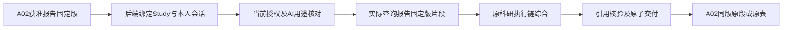

# 已审核报告资产供科研Agent检索与固定版引用：首切片

## 2026-11-17当前状态：AQ02免费切片

用户已批准独立单表/本表最小读追加权限及原A02/AI01局部交互；现已在专用合成库显式应用，首次许可及Audit各1条。完整三步许可强制回滚与真实免费检索/固定来源定位已验证，旧42资产保持；0新会话/Job及模型调用。实际科研Agent生成回答仍在AQ-F01停点，先核账本/次数与价格、准确提案再确认，不重复申请材料用途。下文旧待批/未启用叙述为历史阶段；详见[免费交接](../planning/research-assets-agent-qa-2026-11-16/aq02-delivery-2026-11-17.md)。

## 2026-11-17 · 本研究报告用途已明确批准

用户已允许C2新资产rhab-cc8fc61a-38f6-4cf0-96f7-17d11252d7f2固定v2、原admin、当前Formal Study、既有DeepSeek的本研究AI问答，7天可撤销。取代本规格“用途尚待确认”的当前判断；下文旧adc单例与两版/12事件为历史设计背景。本批沿用新C2已满2版/6事件，不追加内容版或资产事件，不改旧42资产。

AQ01免费准入、14项新测试和351项资产回归已完成，运行许可仍未入库/未启用。新增1表的精确权限和局部交互待[AQ02准确清单](../planning/research-assets-agent-qa-2026-11-16/aq02-minimal-admission-2026-11-17.md)确认，付费仍另核；不是再次申请材料用途。[当前交接与验证边界](../planning/research-assets-agent-qa-2026-11-16/aq01-delivery-2026-11-17.md)覆盖下文旧未执行状态。

2026-11-16｜R1修订：用户要求区分测试边界与正式AI用途授权，撤回“必须新增v3”的前置条件。已确认范围仍为A02进入、绑定来源Study、仅检索当前Study已审核且有AI用途许可的报告资产，原admin报告首验。当前仅修订设计，不批准或执行新许可、版本/DDL、模型费用或上线。

## 目标与最小范围

让研究者在报告资产旁进入科研问答：系统核对当前研究及AI使用条件，按实际问题检索可用报告固定版，回答附逐条来源；点击引用回到同一资产固定版本的原段或表。一次明确许可可复用于后续问题，不要求每问重新选择材料或确认。

首期只接当前Study的报告资产（publication），先验证由实际固定方法报告沉淀的既有具名对象。不纳入跨Study、其他四类资产、联网/新抓取、附件解析、数据集计算、共享/发布/下载/导出或方案自动修改。普通Hub公开资料问答及A02既有六组适用性解读保持原分支，不混充本次能力。

## 已核实事实与假设

1. [首个合成报告资产](research-assets-report-context-2026-11-16.md)为v2/revision6、已审核且私有未发布；原报告固定v1。专用合成库v1/v2的rights_evidence确有“不开放共享与AI”。该文本由Agent在当轮测试脚本中填写，表达当轮只做登记/审核、不调用AI的执行边界；它不是已核验的外部版权禁令，不代表用户规定所有资产禁用AI。误将测试范围写入业务权利字段，不能据此推导必须增版。原记录及测试证据保留，不静默改写。
2. 旧会话、Queue、科研Agent、DeepSeek、Token/计费、当前授权和提交守门可作为复用点。现有Hub使用Orchestrator的kb_search快路径映射到Hub来源适配器；A02既有AI解读是具名固定材料适配，不是通用资产检索，也不是模型自主工具循环。
3. rh_asset已具备固定版、来源policy、审核、用途授权等能力；但现有用途申请需要有效发布，且拒绝为本人申请/共享。不能为了本人私有AI问答先公开/共享资产，也不能伪造一条本人共享。
4. AI01普通对话目前没有真实Study绑定；从A02进入时必须由后端建立研究范围，不能默取用户第一个Study或仅依赖前端URL。
5. 本轮按专用合成环境、原两账号、原Study/admin本人报告设计。租户管理员已有研究权限不替代材料AI用途依据；owner继续只做拒绝验证，不因本切片新增成员或阅读权。

常见错误是将“已审核、可阅读、允许发送模型”合为一个开关，或把固定材料注入称为资产检索。首切片须分别举证许可、真实检索、真实模型执行与固定版引用。

## 测试、材料权利、正式AI许可三层规则

| 层次 | 表达的事实 | 记录位置与变化规则 |
| --- | --- | --- |
| 测试执行边界 | 本轮可用账号、夹具、调用次数/预算，以及是否允许执行AI测试 | 测试计划、审批回执和运行守门；变更测试范围不自动改资产内容版或产生产品许可 |
| 材料权利依据 | 原创声明、来源许可/合同、研究伦理或数据使用条件等实际材料依据 | 由材料责任人核对并留可追溯依据；Agent不得把测试计划当作版权声明。发现真实禁用/限制时不得用操作批准或用户勾选绕过 |
| 正式AI用途许可 | 谁可在什么Study、对哪个固定版、为哪些用途/模型服务使用，何时失效/撤销 | 独立且有版本的授权记录，绑定固定资产/材料依据；许可创建/续期/撤销不自动产生资产内容新版本 |

当前合成记录应先由用户/材料责任人确认该历史文字的性质及真实材料依据，再追加有来源的澄清/确认记录，关联旧v2与原测试回执；不删除原文字、不改旧hash，也不由本次文档纠正自动授予AI许可。真实权利未核清或仍有冲突时维持未授权。

### 是否新增资产版本的判定

- 仅扩大测试执行范围、调整调用预算：不新增资产版本，也不自动授予产品AI权限。
- 在真实材料权利允许范围内新增/续期/缩小/撤销AI用途许可：只变更许可版本与审计，资产内容版保持。
- 对历史测试文字作溯源澄清、补交材料依据：追加依据/复核记录；不因“补一份证明”自动增资产内容版。若必须实质修改既有已封存字段，另按该字段版本规则评审。
- 正文、数据/统计内容、摘要、来源绑定或已审核内容包的用途/适用限制确需实质修改：才形成新的资产固定版及相应审核。不得用许可记录暗改这些内容。
- 实际材料许可明确禁止AI：保持阻断，先取得并核验合法的新依据；不能为了通过验收生成一份新版本便视为解禁。

**当前推荐路径：沿用既有v2，保留两版/12事件边界，独立核对材料依据并记录正式AI许可；不把v3或扩大版本上限作为本切片前置。** 如果免费准入发现技术实现将用途授权与内容版错误耦合，应先提交最小解耦差异，不能为迁就代码自动增版或放宽守门。

## 用户流程与局部页面变化（待随规格批准）

1. A02原AI卡片分别呈现材料依据是否已核对、AI用途是否已授权。依据未知显示“材料使用依据待核对”，许可未具备显示“尚未允许用于AI问答”；依据允许时才提供“允许用于本研究AI问答”，已有有效许可时为“基于本研究报告提问”。沿用原卡片/按钮/14/22，不向普通用户展示开发轮次或预算说明。
2. 用户在同一入口核对材料依据并明确选择当前固定版/本研究AI用途，默认不自动勾选，已有信息由系统带入。当前建议绑定v2，原报告v1、资产v1/v2及已有审核保持；不要求先生成v3、重新审核未变正文，或为本人申请/共享。材料依据复核与许可分别留痕，可在同一提交中记录。
3. 系统仅在材料依据已确认允许、本人已明确同意、同一固定版审核有效且许可未过期/撤销时开放AI（含向既有DeepSeek服务发送获准片段及本人会话原文引用）。科研审核与用途许可逻辑独立，审核本身不产生许可；待审/退回版本不准入。不自动授予他人用途；续期/撤销沿同一入口，不要求每问重新确认。
4. 进入AI01原对话区域，带一个简短、可核对的研究/报告范围标识；不增加Study选择器或固定证据侧栏。首问可编辑，用户发送后才创建本人会话/任务；再次提问沿用本研究范围。
5. 服务端先检索后综合。回答内来源编号由后端生成；点击引用打开A02固定版本并定位原段/表，保留返回问答路径。未发表报告不伪造作者、期刊或DOI。
6. 无可用证据时明确说明未生成研究结论，不调用模型、不转普通Hub/互联网或其他Study兜底。来源暂不可核对时可恢复；许可撤销、过期或身份变化后清除受限正文和迟到回答。

保持A02外侧500px辅助栏、顶部信息及七Tab；AI01维持原历史＋对话两栏。原注册、角色、Study权限、报告审核/发布和其他页面不改。上述两页局部动作、范围标识、引用定位是本切片拟批准差异，不由“接口接线”自行扩布局。

业务页面只呈现当前研究/固定来源、使用条件、回答与引用；不展示本轮开发预算、夹具数量、请求键或hash。必要的模型数据使用同意、来源失效和失败恢复用简短用户语言说明。

## 技术闭环与复用点

### 一、受控检索

- 复用ResearchArtifact/Version、rh_asset registry/policy、原T17同事务来源桥及当前授权锁。候选先按tenant/group/Study、报告类型、有效审核版、当前阅读权、AI许可和原始来源有效性过滤，再返回题名/片段；不能先查全部正文再过滤。
- 默认检索每个资产当前有效的审核版，不能读取待审新草稿替代审核版；一次回答固定所用版本。已有回答的引用不自动跳最新版本，历史版后续能否交付仍按该固定版当前许可及既有来源规则核对。
- 首期用PostgreSQL及既有检索编译/文本处理方式，在题名、用途、限制、正文段落和表格中做有界确定性检索；不新建知识库副本、向量服务或嵌入任务，不冒称已具备向量语义检索。短指代“这份报告”使用会话明确绑定的种子资产，单独记录fixed_asset_read，不伪造关键词命中。
- 拟定每轮最多3份报告、8个完整片段、总计12,000字符，并取当前Token额度/模型上下文门禁允许的更小上限；过大明确要求缩小问题，不截断表头/单位后伪装完整证据，不扩大Token配额。首批环境仍只准入当前一份具名报告。
- 固定版分片规则服务端与A02共用，保留章节路径、段/表块ID、行范围和quoteHash；完整表格块不能被任意换行切坏。仅对资产模式启用定位，默认Markdown禁图片/不可信链接行为不变。

### 二、原科研执行链

复用旧Sessions/KnowledgeChatJob/Worker、原Orchestrator快路径、DeepSeek Provider、Token/Billing与提交当前授权守门。新增Hub内asset-qa适配，不修改app旧系统源码，不重构共享底座。

首期执行策略为“服务端/Orchestrator受控检索一次＋最多一次模型综合”，不建自主多步工具循环。审计同时记录旧slot（如kb_search）与实际能力asset_version_search/read、实际查询/命中/时间/状态；不把该适配说成模型主动调用工具、KB向量命中或联网。

必须在免费准入中验证：旧Session/Queue/Worker能否通过精确来源Study facade复用、现有最终提交事务能否容纳本切片来源重验。若仍绑定旧Study，先提交必要的Hub局部适配，不修改受保护共享启动入口或以错误Study兜底；不能安全复用时停止进入有状态实施。

### 三、固定版引用与科学边界

模型只返回定性回答段落及明确选择的evidenceIds；后端检查来源存在、属于本轮证据、直接相关且有当前许可后编号、渲染。缺失/越界/伪造来源拒绝，不将首条来源随意补给无依据段落。

每个引用绑定tenant/Study、assetId、assetVersion、artifactVersionId、contentHash、policyHash、consentId/revision、原报告ID/固定版及fragmentId/quoteHash。点击按此绑定打开A02同版原段或表，不按题名猜源、不跳head。

统计数值、单位和表格只由后端从固定原文或既有确定性运行结果原样交付；LLM不重算、补值、打分或改写阈值/概率。自由回答的数值仍走既有数值守门，所需原数值由引用原表展示。合成报告、历史结果与新研究结论明确区分；缺声明/缺字段登记未提供，不推断疗效、临床适用或统计等效。

问答内可追溯来源不等于A01对外书目引用登记，不执行原有需发布的cite/共享流程，也不开放下载或导出。

## 最小数据增量（建议，未执行）

1. 原资产固定版、审核和源绑定全部复用，当前以v2为目标；不计划新增v3，不扩大两版/12事件上限，不改变既有6笔资产事件。已封存D03迁移、原报告和v1/v2均不重写。若实施中确需其他DDL或内容修订，必须单列具体差异，不能包含在“修正测试说明”里自动执行。
2. AI用途许可独立绑定assetId/version、tenant/group/Study、受益人/用途、contentHash/policyHash、材料依据记录及其版本/hash、providerScope、consentRevision、授予者/期限/撤销信息。材料依据澄清有确认者、时间、来源及关联旧测试证据，不能仅由Agent文字分类产生允许结论。优先核对既有用途能力是否可在不伪造本人共享、不先发布的条件下复用；一张rh_asset.ai_use_consent是无法安全复用时的候选方案，并非已确定必须新建的表。具体表/字段/守门差异在AQ01后冻结并按必要范围批准。
3. 同一固定版/受益人/用途仅一个有效许可；创建/续期/撤销有CAS、幂等和同事务AuditLog，不以每次问答消耗asset_event或增加资产内容版。生效必须同时满足材料依据允许、该版已审核/来源与阅读权有效、期限有效且未撤销。许可不产生Study成员、阅读、共享、文件或其他资产用途权限。正式产品期限来自权利依据；本机首验可提出最多7天的有界许可，但仍待批准，不自动续期，不把夹具期限当永久规则。
4. 对话及问答证据复用Session、KnowledgeChatJob与Message.meta/provenance，不新增问答库。每轮保存检索轨迹、固定证据manifest、模型/已知用量及引用；服务端留存失效原件供审计，用户读取时按当前许可重投影。

不把AuditLog单独当权限库，不删除或覆盖v2历史文字，不把该段Agent测试说明当作真实版权禁令，也不反向把它忽略成“已经允许AI”。必须核清材料依据并另有明确、可审计的正式许可；当前均未写入。未来其他资产/跨Study不在本切片准入范围内。

## 服务契约与一致性

核心接口职责（拟定，准入阶段核对现有路由后冻结具体DTO）：

| 能力 | 契约 |
| --- | --- |
| 准入读取 | 返回当前固定版审核/来源/AI用途状态及下一动作；服务端判定，不读客户端admin声明 |
| 材料依据核对/AI用途确认 | 绑定既有固定版、依据记录/版本/hash、确认者及幂等键；只追加依据与许可记录，不派生v3、不收客户端统计正文或改旧policy |
| 私有AI许可 | 仅本人获准固定版，创建/续期/撤销；expectedConsentRevision、幂等键、用途/期限/材料依据绑定；其他人和其他动作拒绝 |
| 研究问答会话 | 从已授权A02固定版派生并绑定真实Study/本人/contextKey；消息/任务/历史尽量复用原Sessions接口，服务端不接受任意改scope |
| 检索/固定读取 | query/topK及本轮受控证据句柄；范围来自已核验会话，不允许浏览器/模型绕过到其他Study |
| 引用交付 | 固定asset/version/fragment及绑定摘要；A02同版当前授权重验后定位，缺失/不匹配明确失败，不回退最新 |

提交前核对Study、角色/账号、会话/Job当前状态与claim/版本、资产审核/源报告、许可版本/期限及所有证据hash。沿原授权锁顺序，在最终Message与计费提交事务中锁定相关许可/父对象并重验；失效先于输出格式报错，不将外部模型返回视为已交付。

撤销后禁止新请求/准备/提交/历史正文及引用交付；若Provider已在途，尽力取消并按真实已知用量对账，不能假设未交付就免费。未知用量按现有Billing待核流程处理，不补造0、不重复扣款。页面已交付且被人复制的内容无法收回，不作相反承诺。

无证据/no_evidence、来源暂不可核对/unavailable、当前权限拒绝/forbidden、输入或固定版冲突/conflict分别显示，不以空成功替代失败。未知提交先GET原结果，不自动重复POST/模型请求；身份变化及迟到200不得复活私有回答。

## 验收标准

1. 免费契约/真实合成PG：当前Study绑定、已审核版选择、AI许可与阅读权同时必要；跨tenant/Study、草稿、无许可/过期/撤销、变版/hash不一致均拒绝，无片段泄漏。v1/v2原件、旧资产/角色/账本指纹保持。
2. 正向实际任务：新问题“概括这份报告的数据完整性和使用限制，并引用原文”，实际检索、实际Provider及逐段引用齐全；默认通过链接回A02既有v2/原报告v1原段或表，数值与原文一致但由确定性显示，不由模型重算。若该路径需要新资产内容版才能运行，应先判为设计/实现耦合待处理，不能偷偷升级版本。
3. 使用不同措辞/新问题再次验证，不能靠验收句硬编码或固定注入全部正文代替检索；不承诺本切片已做跨轮科研记忆，旧回答不是证据。
4. 不存在的随访/疗效问题无证据时明确不下结论，实际Provider请求0，不转其他来源兜底。
5. 许可撤销真实在途验证：实际Provider已开始后撤销本轮许可，最终不交付回答/引用，保留真实已知用量；历史已生成答案重读受限。授权恢复须新许可和用户新请求，不自动重发。
6. 原admin正向与原owner真实403；UI-only受限/503、丢响应同键查回、实际注销迟到200、固定历史版定位/登录返回均有Chrome截图录屏。普通Hub/既有A02解读回归，不新增本切片之外的业务写入口或改变已确认布局；本切片局部动作仍须按AQ-M04批准。
7. 四层独立记录：代码实现、目标本机装配、真实检索/Provider执行、科研用户可用产物。无配置或工具执行必须阻断/明示；只有Mock或免费回放不算真实AI验收，专业签收及生产另列。
8. 反例分别覆盖：历史测试文字不自动成为真实禁令；真实材料禁用不被新许可绕过；单有AI测试执行批准不产生正式AI许可；许可创建/续期/撤销不增加资产内容版。任何历史文字澄清本身不得触发模型调用。

## 待批准的最小实施与授权

| 项 | 具体边界 |
| --- | --- |
| AQ-M01（R1替代旧提案） | 仅当前具名合成材料的依据核对、责任人确认及追加溯源澄清；不生成v3，不改原报告/v1/v2，不扩大两版/12事件，不由澄清自动授予AI许可 |
| AQ-M02（R1） | 独立绑定既有v2的正式AI用途许可，先核验可复用能力；只原admin本人，具名创建/续期/撤销可审计。具体是否新增表/必要守门在AQ01后另列准确差异批准，不含上限扩容或旧共享规则泛化 |
| AQ-M03 | 当前Study内asset-qa会话/任务及内部固定版证据交付，复用已具备的chat/Agent权限；原owner只做拒绝用例，不授予其源报告或新资产访问 |
| AQ-M04 | A02原AI卡入口/许可对话与AI01范围标识/回答来源、A02原文定位上述局部交互；不改整体母版或普通Hub会话范围 |
| AQ-F01 | 后续另行批准才核对公开价格和真实模型验收。建议最多4个新具名问答任务、3次实际Provider请求（两成功＋一在途撤销；无证据免费），不自动重试；先核验当前累计任务/请求账本再提交总额度，不能据原5元尚未耗尽推导请求配额可续。费用仍受原5元累计上限，不充值，不自动续额 |

当前只确认了产品范围和本次文档纠正要求，以上M/F未执行。旧AQ-M01的“新增v3/扩至3版”提案撤回，由R1取代；用户此前选择研究范围不代表批准新许可或DDL。下一项只建议免费准入核对材料依据/许可承载与旧链复用，不写资产、许可或迁移；有状态实施和付费门禁均在具体差异可评审后确认。云、远端配置、旧服务停线和真实发布仍须另确认。

本轮不增加Token配额；余额、总任务/请求额度或原费用余额不足时单独停下确认，不能由一次模型请求的估价替代累计账本核对。

## 实施顺序与工期建议

仍以3个有效工作日＋1天缓冲为估算：免费准入及依据/会话/提交复用核对0.5天；独立用途许可的最小适配0.5天；确定性检索/固定片段/引用0.75天；原执行链与当前提交/历史重投影0.75天；两页原位接线/浏览器及独评收口0.5天。已移除强制v3及重新审核未变正文的工序；若需新表或其他适配，在准入后按准确差异复估，不用原估算兜住新增范围。审批等待、环境协调、用户专业验收另计。

保持当前目录串行实施＋一次独立总评。若准入发现跨Study服务装配或提交事务无法在Hub小适配内完成，先停并给出具体最小差异，不扩展共享底座或启动新索引/排空专项。完成后再讨论其他资产类型和跨Study检索。
