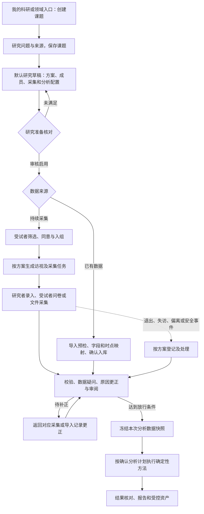

## 2026-11-18 · WF12四阶段贯通，12项串行优化完成（本机合成）

S01原准备卡统一“准备研究→完成访视→分析结果→审核交付”，保留当前Study；今日待访视补全部访视入口，无新增左侧菜单。无权阶段仅提示，不推断整课题完成。S05统一分析名称/参与阻断语境并修复1024撑宽；S10复用既有读取显示当前课题名，固定正文/摘要不变。准备卡随内容增高，六宽/200%逐入口可见、键盘与三点命中均核。

69相关、3个真实PG整体回滚、最终构建5.44秒；两条完整实际旅程、500/真实身份切换恢复、两份原Word正文及6/7表一致。仅2条下载审计，0新采集/计算/报告/任务/文件，旧81+7+3表、591任务与科学Word保护通过。WF01–WF12已按各项范围完成本机合成验收，原历史记录保留；真实临床/生产未验，非全站Shell或全仓无遗留声明。[最终验收](../testing/study-workflow-wf12-2026-11-18.md) · [契约](../technical/study-workflow-wf12-2026-11-18.md) · [完整路线](用户验证与操作手册.md#17-wf12四阶段完整操作路线)。

## 2026-11-17 · WF07确认数据并开始分析（本机合成结果已核）

已批准普通描述统计与整课题计划内，自动只读准备原数据预览；人填写放行理由，经一次站内确认顺序放行固定快照并开始本次确定性计算。原“仅放行快照”、计划审批、权限/用途/同意/盲态/质量阻断、来源与逐项审计保持；结果仍待原独立审核，不自动报告或发布。普通create直接执行，整课题create含首片再按原process推进，未新增API/schema/Worker或临床计算规则。

未知先原键GET；404不证明未执行，明确继续才沿相同原键/请求及固定来源办理，成功步骤不重播。新旧Methods创建双向互斥，旧未知创建不被来源403或原结果审核覆盖。稳定恢复控件与独立plan/revision输入绑定保确认反馈、焦点及首render旧值隔离；已核终态归档但保历史，partial回看不清未知。离页后持久后台执行尚未实施。

V4四例在60890完成82snapshot/80run/34operation/302业务audit，0新Session/0review，两个full各39实际计算、15不适用未执行。代码相关141/native60、完整前端1257总/1256pass/1skip/0fail、构建4.87秒有据。近期列表断连传播另以4产品+3测试最小增量保全列表及原核源：仅断连后不再启动下一项，当前项完整结算、不返截断200；相关28/native60/根24/独立19+5与真实随机HTTP前RED后2pass、构建5.03秒已核。

owned装配60890→17319后只做读回，原13代码/测试不变；无注入原顺序两个ordinary前缀ready、full GET200/5902ms、严格0写。完整readonly及正常recent已通过，关键图根核；三个稳定负例UI已在17319独立补证通过，native两404/旧409一致，旧Gate瞬态图保留不当最终态；本机合成四层、20源末核及三个稳定负例UI独评通过；Notion同步记录及最终完成状态见本项final-manifest、不重算旧80条；管理员正向，原科研身份对这两个Study404为隔离反例。旧失败/原partial/科学Word/591队列和七表保护保留，正常recent实际31项、HTTP200/20811ms、顺序/metadata/MD5一致及严格0写，不称50满额或浏览器列表性能通过；WF08–WF12未开始，临床与生产未验。[当前报告](../testing/study-workflow-wf07-2026-11-17.md) · [统一手册第12节](用户验证与操作手册.md#12-wf07确认数据并开始分析)。

## 2026-11-17 · WF06集中审阅关注项优先（本机合成已验）

原S09清单默认全显、明确关注项稳定前置；“需关注”只筛原明确状态，当前范围失焦仍可辨，原因在原题之前。不默认勾选，不把已锁定误当资料完整或仍待审核，不以筛选替代逐题核对、原S05疑问或审核责任。切范围/身份/来源后重新选择；每批原20份上限显示限制，减至合法范围后仍原确认，无截取/自动分批。原审锁、完访和恢复方法不变。

V6代码/独评、当前全前端1197pass/1skip/0fail、同源两角色及五宽/native200、原题答案/单位/S05/确认取消与三次fresh0写/591job/科学Word保护达到本机范围标准。此次真实验收只查看、筛选、选择、开确认后取消，无最终审核/锁/完访；RECOVERY两身份均eligible2，N/A/uncertain字面样例为0/0，不虚写分支已验。WF06本机合成已验；Notion同步及最终完成状态见本项final-manifest。 WF07未开始，待根最终清单后按序；临床/生产未验。[本项报告](../testing/study-workflow-wf06-2026-11-17.md)。

## 2026-11-17 · WF05正式概览直达今日访视（本模块已验）

已有研究的正式S01原空更新卡呈现“今日待访视”，原Shell/导航/列布局及其他入口保留。按服务端北京时间日历日筛同研究、有效入组、未完成/取消且已安排的访视，今日晚些窗口可列而不冒称已开始；未来日/pending_anchor/退出/删除/fixture排除，原固定executing或合法superseded父链逐行核验。安排列表不替代同意或采集许可，进入原S09后继续完整守门。

初始5条，明确查看更多每次最多20条，按真实cursor续页且不无界扫描；本机22条以首5+17一次展开。已展示行“进入本次访视”直达同一canonical visitId，由原3次导航减为1次；本例含展开为2动作，不宣传总点击1次。纯GET/0业务写，500清旧表、显式重读及clean reload不防丢失拦截，actor/version/Study/URL隔离不存本机恢复标记。

V3相关/独评99、JSX3、build5.61秒，双角色22条/1more、五宽/native200正确视频帧及完整旧保护证明本机模块标准。原V3全前端1084通过/4失败/1跳过保留为历史attempt。最新共享准入装配后根在74871实测9GET及双身份首5→1more22、完整native href一致，fresh全旧行/591/科学/Word及本窗口准入metadata另保护通过，0采集/业务写；最新构建4.71秒，当前全前端1176总/1175pass/1skip/0fail及fixture14/14、末次全旧行/591/科学/Word/角色和准入两表fullrowhash另保护均通过；原两fixture配置attempt中止，不填完整计数。原V1/V2、日期P2、QA计数失败、phase1独立AI01新事件严格失败与过渡交接均保留，不归因F01或声称全球0增量。末审原sourceGateSliceContinuityPending=true保留，已由根后续还原快照wholeSHA命中目标2a90…及精确diff证明仅独立list不同、读取切片同hash而关闭；policy仅owner不变声明/current hash，不冒称旧独立核验。WF05已完成（本机合成），Notion同步记录见finalmanifest，不背书F01独立list。WF06代码未开始，临床/生产未验。[证据与边界](../testing/study-workflow-wf05-2026-11-17.md)。

## 2026-11-17 · WF04集中入组核对（本机合成核心结果已核）

S03建档后在原S04“筛选、同意与入组”卡片完成核对。共同决定日期和签署主体填写一次，各条仍分别明确筛选结论、研究参与同意、数据使用同意及各自依据，可按条改日期/签署主体；无默认决定或同意。“保存核对记录”依次保存本次明确选择且完整的条目，系统重读满足条件后，再单独“确认入组”。正常三项保存加明确入组由四个主动作减为两个，不是总点击数；不合格、未知或撤回不入组。原单项更正、历史、撤回与退出保留。

原生事件/入组继续分别授权、锁后CAS、固定政策及原子审计，不新增复合API、DDL或角色。未知先严格原回执GET，404仍未知；核回后明确继续剩余条目，不自动续写。临时读取失败保输入，真实身份/URL或明确失权清活跃回显；已提交正文只按原15分钟期限保留，到期只保opaque恢复证据。

本机原生UI恰3新Subject/7事件/2入组，12proofs对应24本项业务审计；两位成功入组各生成原native访视/要求及fallback任务，零表单分配/启动/答案。A三记录一次保存并在enroll丢响应后严格GET恢复；B原科研authVersion0完成分步、同意200丢响应/真实刷新/原marker保留/GET/明确继续；D仅筛选失败。代码、目标装配、真实请求和核心业务结果有证，原390过渡/hover遮挡失败图保留，新鲜390三点命中/侧栏right=0已只读补证，产品/Shell未改；独立终核通过，文档同步记录见本项最终清单；真实临床与生产未验。[本项验收与保留项](../testing/study-workflow-wf04-2026-11-17.md)。

## 2026-11-13 · 表5首版项目操作规则v1已确认

用户明确回复采用首版规则：舌/脉类别由临床评定者确认；双脉同有保留观测、待复核，不自动共计；不适用/无法判断/漏答分开、不补0，条件不足时总分与诊断留空。canonical已升级confirmed及project-policy-v1，确认记录明确为project-user-confirmation；原pending按字节归档，不覆盖已发布固定版或历史答卷。

这只是三项项目操作规则确认。原12权重、>=20且组合及PHQ原表交互不变；实际课题/组/PI尚未绑定，完整方案/其他表单和专业业务验收仍未完成。无患者、真实邮件、权限/DDL/入口/生产变更。新批准版9项配置定向、合并相关66项、真实HTTP/PG及Chrome三固定修订回看均通过；旧测试的synthetic确认仍保留为历史，不冒称本次人类确认。

[确认记录](../planning/study-form-electronic-scoring-2026-11-13/rule-confirmation-v1.md) · [当前规格](study-form-electronic-scoring-2026-11-13.md) · [确认后复验](../testing/study-form-rule-confirmation-2026-11-13.md)。下方“策略待确认”仅为先前阶段记录，已由本次明确回复解除。

## 2026-11-13 · 表5电子计分与PHQ-9原表展示（本机合成技术验证）

PHQ-9现场/H5/预览使用四个原文选项、两周指导语和致谢；无默认0，保留整数，核对/更正/固定历史显示源标签。表5固定12项临床权重、>=20且组合，舌脉类别显式记录；不适用/无法判断/双脉待复核可留存正式revision但无总分/标签，漏答不补0。后台和前端均限制表5为研究人员评定，PHQ继续两渠道。复用原锁/同意/权限/审阅/审计，不改旧系统或公共Shell。

本机19501/19502实际请求、PG revision哈希、Chrome PNG/WebM和原生200%通过；59后端采集、13方案/模式、40前端定向及构建通过，一次独审无新增问题。最新全量前端627中626通过/1并行资产模块失败，不宣称全仓全绿。canonical表5策略仍pending，合成confirmed不代表临床批准；实际课题身份、五主症规则与专业签认仍待完成。无生产发布、DDL/权限变化、真实邮件或模型调用。

[实施规格](study-form-electronic-scoring-2026-11-13.md) · [技术契约](../technical/study-form-electronic-scoring-2026-11-13.md) · [验证报告](../testing/study-form-electronic-scoring-2026-11-13.md)。下方V0.7为原件阶段历史，不作为当前电子化状态。

## 2026-11-13 · 首个正式课题方案校准（V0.7原件补齐，操作规则待审）

[底稿V0.7](first-real-study-calibration-2026-11-13.md)已根据用户补交的方格2023论文及三份CRF更新。主量表PDF第3页表5的12项有/无、最终临床赋分、总分≥20及“主症2条+次症至少1条（共6条）+舌象/脉象至少1类”原句已核，48个数值单元与17项Python源核对通过，主量表原文登录阻断解除。来源是2023研究论文，不继续登记为已核实团标；不把建模小数权重、4.3或总分单条件替代临床规则。

三份空白CRF完成30条文件×量表盘点及8项一致性核对：六型/五型表非目标证候，PHQ均为15不是9，HAMD17特殊9不计分，HAMA编号重复及SHAPS缺表等已留痕。不能整包加入当前课题，双相纳排不移用。舌脉类别/共计、月经项不适用与缺失、施测操作规则和五主症>4原始患者计分仍待冻结。新增[原件核查与复用清单](../planning/first-real-study-calibration-2026-11-13/received-source-review-v7/README.md)。

原PHQ9官方内容及7项准备材料、65/29项既有离线契约保持，显示/受控发布入口仍未完成。正式题名、病内比较/健康参照分离、0/2/4/8周四访视、EEG仅V1/V4及待审窗口/录音/组名均不变。整体核心表单未全部定版，未发布、分配、启用或作真实临床/生产验收。

本轮仅文献/空白模板与配置内容更新，无运行代码/API/Schema/UI/数据库/19501变更或业务请求/通知；功能构建、界面/Playwright与使用说明/产品基线更新不适用，不把源核对称为四层验收。V0.6归档、原件哈希和Notion原页定向同步记录保留在本轮规划目录；原19项通用合成验收范围保持。

## 2026-11-13 · 科研课题流程19项验收完成

用户已对更正后最终Word报告明确回复“核对通过”。T00–T18共19项的代码、目标本机配置、真实执行与通用合成业务验收全部完成；[业务验收原件](../testing/evidence/research-t18-2026-11-12/corrected-report-6277b638/business-acceptance.json)绑定同一报告和文件摘要。真实临床规则、专业签认与生产验收仍独立未验。以下技术阶段的“待用户反馈”属于验收前历史，当前状态以本段及机器台账为准。

## 2026-11-13 · T18 同一研究更正后报告技术闭环

T00–T17保持本机通用合成软件范围通过。T18在同一主Study完成现场、实际邮件H5与CSV采集，原固定分析/报告交付后，仅现场观察值0→1形成ref2；重新审阅锁定、访视重核及新快照完成，原批准计划不变。原H5的1.5/2/是、CSV的4/缺失/是及来源、时间、批次保持，旧当前结果/报告/文件受阻，旧历史和已下载原文件保留。更正后同一新Run实际计算一次并人工确认，新artifact/v1报告已审核、发布、真实Word下载并逐页检查。

S06指定运行/快照先核当前权限和来源；近期列表独立读取并区分加载、失败和真实空态，原页面结构与审核流程保持。数值由确定性算子执行，对照预先冻结的Python基准；报告严格复制持久Run。

T18最终报告已于2026-11-13获用户明确“核对通过”，本机通用合成流程四层完成；临床规则、专业签认和生产验收仍未完成。此前阶段性的“更正后待执行”记载为历史，以本段及[同例验收](../testing/research-study-workflow-2026-11-12.md)、[角色矩阵](../planning/research-study-workflow-2026-11-11/t18-final-role-compatibility-matrix.md)为准。

## 2026-11-12 · T17 S10 固定报告整页本机合成验收闭环

已确认的当前描述统计可在同一研究生成固定v1报告，带理由审核、发布并生成真实Word文件；正文不可编辑，数值逐项来自已保存Run，字段名称/单位和来源可复核。已发布是本研究私有固定报告，不自动公开或创建科研资产。新报告中文真表格及附录、旧正文/旧文件兼容、当前权限/用途/来源和下载前后检查均保留。

S01科研产出、S06“生成固定报告”沿当前Study进入S10；原单列、8页签与Shell保留，窄屏页签横滚。既有报告的阅读不强制Methods执行授权；无导出权不读取文件任务。四动作未知只查原键，来源失效不再展示旧正文/文件；后台quiet读取不会吞掉显式下载。全量前端/隔离构建、真实管理员四动作/Word、只读角色、恢复/TTL/文件安全/三视口及独审已通过本机通用合成范围。

[专项测试](../testing/research-t17-2026-11-12.md)与[技术说明](../technical/research-t17-2026-11-12.md)记精确证据。公共Shell在390和原生200%顶部搜索/身份区仍有既有拥挤重叠，作为工程兼容限制保留，本页正文/数值/确认/返回可用；不声称全页无问题。T18主同例报告和更正后新结果、用户业务核对继续，临床与生产未验。

## 2026-11-12 · S06确定性描述统计闭环

S05当前有效快照可进入S06显式描述统计，真实Methods/Worker/持久Run与有权人工核对接通。0/false/缺失及不可估计保真，字段中文标签与来源可核；无可验证的疗效/安全性/AI结果保持明确空态。最近50条及失效元数据范围明示。未知仅核原create/review，取消只核当前状态；已保存但当前GET503清旧值、保留原标记，十五分钟清意见，当前撤回/失权清受限内容。469前端/隔离构建、真实角色/恢复/三视口和独审通过；数字完整单行不舍入。仅本机通用合成四层，临床/生产未验。[证据](../testing/research-t16-2026-11-12.md)。

## 2026-11-12 · S05分析数据放行闭环

在既有数据质量页完成明确3名合成受试者/固定字段的计划、审批、逐值来源预览、真实疑问阻断和带理由快照放行。普通分析研究者只读/预览，写动作按当前实际权限；0/false/缺失与未知单位保真，来源变化停用旧投影。原回执成功但当前快照不可核对时保留标记，只查原结果，不假称当前可用。459前端、隔离构建、实际角色/故障/桌面390原生200及独审通过。仅本机通用合成四层，临床/生产未验。[证据](../testing/research-t15-2026-11-12.md)。

## 2026-11-12 · 研究交接与当前权限验收

真实课题/Study/执行项目父链和当前授权交接继续复用公共事务；Hub关注不授研究数据权，新关注者从HTTP/PG到P01/Q02/Q01/S01/S09均真实验证。需要尚不可用盲态/中心机制时执行政策明确阻止提交，不能把独立方案检查通过误当可启用。启动Hub结构检查已改只读，缺失拒绝；本机93446七服务ready。仅通用合成四层，临床/生产/生产迁移恢复未验。[证据](../testing/research-t00-t01-2026-11-12.md)。

## 2026-11-12 · S09文件与处理来源闭环

文件折叠区支持真实预处理CSV/JSON导入、固定访视/任务/特征来源及完整分页，未知结果只核原操作，当前撤回清内容；存储重新核验不重复上传。管理员写入与研究者只读、对象不匹配/恢复、501来源/22任务、桌面/390/原生200%已真实浏览器验证；447前端/隔离构建及独审通过。仅本机通用合成软件四层，临床/生产未验，不代表新科学算子、质量合格或自动完成访视。[证据](../testing/research-t14-2026-11-12.md)。

## 2026-11-12 · T02/T03创建与目录最新回归

当前19501以新合成课题完成P01查看更多→Q02→Q01保存/刷新/编辑→建立默认Study→S01继续，原子父链、同键唯一性、管理员无逐Study成员读取和viewer拒绝已实测；首页与完整目录同范围/前缀/总数，390/320页面通过。31服务/契约、16客户端通过，当前Chrome截图/WebM及失败轨迹保留。[证据](../testing/research-t02-t03-current-2026-11-12.md)。仅本机通用合成软件，临床/生产未验；本次回归无新客户发布批次。

## 2026-11-12 · 真实邮件H5闭环与提交页反馈修复

原邀请仅发送一次，邮件服务接受，用户在垃圾邮件找到并从原邀请成功提交。后台同一patient_h5分配保存第1正式修订、未计分；实际观察值1.5、选填观察值2、已完成true，与建议演示值不同，保留实际记录并另生成后续基准，不覆盖原值。收件、提交事实与单持久发送次数已复核。

H5补齐本机严格同源客户端证明，服务器Origin规则保持；邀请令牌不进Referrer。完成态仅一个可朗读提示。后台10秒/focus继续核对当前权限与用途，静默核对不闪动或禁用字段；旧GET不能覆盖新的提交态，当前撤回仍清答案。真实两段25秒、旧请求跨写、撤回、原H5整链及独立合成hook反例均通过。仅19501本机通用合成软件验收，临床和生产未验。[页面修复与证据](../planning/research-study-workflow-2026-11-11/t11-h5-quiet-fix.md)。

## 2026-11-12 · T13 CSV录入本机合成闭环

S09现有访视列表卡内提供折叠“批量录入（CSV）”，访视批量录入动作回到同一区域。只选固定要求允许研究者录入的已发布版本，支持空模板、UTF-8文件或粘贴、逐行字段预检与共享弹窗整批提交。已有内容不覆盖，0/false/null保真；未编辑文件含BOM、CRLF及引号内多行值逐字保留。成功逐行回链本批固定修订；更正保留原修订。未知提交只核原回执，十五分钟后清正文，刷新不重放写。权限/用途丢失清内容，显式重核只恢复空入口。441项前端、真实管理员/研究者/无权owner、故障恢复、实际保存及三视口PNG/WebM通过。仅19501通用合成软件验收，临床/生产未验。详见../planning/research-study-workflow-2026-11-11/t13-ui-checkpoint.md。

# ResearchHub 科研课题全流程设计（评审草案）

## 2026-11-12 · H5自填与邮件邀请（本机）

受邀者可通过受限问卷填写、暂存、刷新继续及确认提交，后台研究者/管理员回收同一正式修订。每次读写及回执均核对问卷目标，多标签错配拒绝并清答案；未知结果只核对原请求。S09在原采集要求行内确认邮件同意后显式发一次邀请；采集方式在新方案草稿与详情一致。H5/后台页面、真实HTTP、435前端及隔离构建通过。真实测试邮件已被SMTP接受，实际收件与该邀请提交待用户确认，T12业务验收未完成。临床、生产及后续分析交付未因此完成。[证据](../testing/research-t11-t12-2026-11-12.md)。

## 2026-11-12 · 正式任务关联与验收（本机合成软件通过）

管理员可在S08创建、编辑、分派和独立验收正式任务；研究者可开始并提交固定答卷修订证据。关联、解除和回链核对当前权限、同意与完整父链；来源更正保留旧固定证据，失权不显示旧摘要或回链。任务验收不自动完成访视。未知结果仅查原回执，404仍保持未知，CAS保留输入。真实PG/HTTP、两角色新任务浏览器及恢复/分页/三视口、426项前端与独立构建通过。仅本机通用合成软件四层，临床专业、生产及T11–T18未完成。[证据](../testing/research-t10-2026-11-12.md)。

## 2026-11-12 · 正式访视采集、疑问与审阅（本机合成软件通过）

研究者可在已授权Study选择正式访视、固定表单，保存草稿并提交；0和false保留，缺失不自动标为未测。提交后的更正须说明原因并保留历史。疑问固定对应修订与字段，可回复和按理由关闭；更正不自动关闭疑问。具备相应权限者审阅、锁定并完成访视；依据更改后须重新审阅并显式重核。未知提交先核对原回执，未查到仍保持未知、不自动重发。此结论仅本机通用合成软件四层，真实临床、生产、T10–T18及后续撤回全链未验收。[证据](../testing/research-t07-t09-2026-11-12.md)。

## 2026-11-12 · T05 审批启用（本机通用合成软件验收通过）

本机通用合成研究中，研究者可提交方案，具权管理员可在治理待办审核并批准、启用；政策缺失及不受支持的中心或盲态机制阻断启用。新版默认保留原入组和访视版本。历史入组转版已取得真实HTTP候选分页、影响预览、受阻案例、指定对象执行、旧记录保留、回执重放和权限拒绝证据；最终浏览器闭环已验证，本机通用合成软件流程四层通过。真实临床政策、专业验收和生产部署未完成。

T06本机通用合成软件流程四层通过：真实PG、HTTP及研究者/管理员 S03/S04 浏览器覆盖建档、筛选、同意、入组、撤回、失权和未知结果恢复。真实回执200后重读当前退出状态，404刷新仍保持未知且不自动重发；历史失败保留。[证据及限制](../testing/research-t05-t06-2026-11-12.md)。真实临床规则、专业验收和生产部署均未完成；T07及后续异步分析处理链的撤回全链未验收。

## 2026-11-11 · T04研究采集配置（本机合成流程通过）

新研究草稿配置支持保存和回读访视及固定版本要求，区分未确认、0和false；本机专用合成范围的PG、HTTP及真实浏览器流程已验证。方案审批、正式启用和采集不由草稿保存自动完成；本机通用合成软件流程通过；专业临床和生产验收仍未完成。真实临床政策与材料需课题组确认。详见[验收台账](../testing/research-t04-2026-11-11.md)。

版本：V0.1 · 2026-11-11  
状态：**全流程设计蓝图；用户已批准开始代码，首批创建切片进入本机技术验收，其余采集/问卷/分析仍按任务实施。** 用户已确认目标系统为 ResearchHub（岐研）。首批实现和边界以[创建规格](research-study-creation-2026-11-11.md)为准，不将整份蓝图记为已交付。

[本轮核对、独立评审与验证记录](../planning/research-study-workflow-2026-11-11/review.md)。

## 1. 目标、依据与结论

本轮需求：结合当前项目和既有方案，设计课题创建、数据录入、数据分析、访视与问卷调查等科研课题流程，为系统实施提供统一业务蓝图。

推荐主线：**形成课题 → 建立研究 → 确认方案与采集配置 → 启动与入组 → 访视/问卷/数据采集 → 核查与审阅 → 冻结分析数据 → 确定性分析 → 报告与科研资产。**

以“一个研究真正做完”为验收单位。问卷、文件上传、任务、AI 对话分别服务于这条主线，不各自建立孤立流程。系统默认带入当前课题、被试、访视、版本和权限，研究者主要回答“这次要做什么、还缺什么、下一步是什么”。

本稿依据本轮源码与文档只读核对；没有访问临床数据库、读取真实被试数据或重跑历史验收。既有本机验证记录只作历史证据，不能据此承诺当前生产能力。

### 1.1 既有设计的继承关系

| 资料 | 本轮继承内容 | 使用边界 |
| --- | --- | --- |
| [产品架构基线](product-baseline.md)、[PRD V2.1](lingshu-product-prd-v2.0.md) | Hub、Project、Study、Protocol 的分工；自建 EDC 目标 | 以最新规则为准，早期“全部演示”和后续局部验证不能混报 |
| [用户路径与页面功能](lingshu-user-journeys-pages-v2.0.md) | Q01、S01–S11 既有职责，成员与 PI 旅程 | 保留公共 Shell 和已确认布局，本稿不授权改版 |
| [执行准备](research-execution-preparation-spec-2026-10-23.md)、[合成 EDC](synthetic-edc-spec-2026-10-23.md) | 配置版本、试填、保存、更正、历史与失效 | 可复用契约和交互；合成记录包不转作正式答卷 |
| [CRF 方法执行](synthetic-crf-methods-spec-2026-10-25.md) | 固定输入、确定性检查、AI 解释、报告溯源 | 缺失/人工范围检查不等于疗效分析 |
| [S08 整页规格](study-tasks-s08-complete-spec-2026-11-02.md) | 工作分派、提交、验收、提醒和关联 | 任务完成不替代访视完成或数据放行 |
| [旧底座专业 Skill 规格](../../../docs/product/11-中医临床研究专业Skill扩展需求规格.md)、[课题执行讲解流程](../../../docs/product/18-课题执行客户讲解流程与话术.md) | 方案、入组、访视证据、研究者 eCRF/H5、确定性计分与质控 | 是复用来源，不能视为 ResearchHub 已正式接入 |

## 2. 当前实现及真正缺口

| 环节 | 本轮确认的事实 | 正式落地缺口 |
| --- | --- | --- |
| 创建课题 | Q01 真实分支需已有 researchPlanId；后端在现存执行范围内创建本人 protocol_draft 产物 | 正式课题创建、Study 建立及两者映射；不能把保存方案草稿算作完成立项 |
| 研究设计 | 已有本人方案/PICO、执行准备配置及版本化切片 | 从草稿到正式 Protocol 的显式交接、专业确认、审批和启用 |
| 受试者及录入 | S03/S04/S05 有真实持久化的本人合成记录包、保存、更正和质控 | 正式 Subject、Enrollment、Visit、FormResponse 的页面与服务闭环 |
| 访视 | S09 真实模式未放行；演示分支含 DEMO 编号和示例评分 | 正式访视清单、窗口、必采项、证据关联、提交与复核 |
| 问卷 | 旧底座已有版本化表单、研究者填写和 H5 邀请/会话模型 | Hub 正式问卷分配与回收；旧沙箱发送不能承诺真实投递 |
| 任务协作 | S08 已局部复用旧事务核心，历史本机 HTTP/PG/Chrome 有据 | 当前装配仍限制合成库/具名对象且 allowFormal:false；须完成正式服务装配和验收 |
| 数据治理 | 旧底座有疑问、偏离、质控放行和审计；合成包有修订参考 | 正式答卷修订、签署/锁定/解锁、质量作用域与失效联动 |
| 分析 | S06 有合成 CRF 的 Python 缺失/人工范围检查及 AI 解释 | 正式问卷/量表/检查值到分析变量的投影，确认 SAP、冻结快照和约定统计方法 |
| 成果 | 已有本人报告/资产候选切片及版本来源 | 正式研究结果到审阅、受控导出、共享或公开的完整交接 |

旧模型还有三项不能忽略：通用 FormResponse 提交后禁止修改、缺正式答卷修订实体；ScaleResult/Feature 未直接绑定 subjectVisitId，部分访视证据按时间窗匹配；通用问卷提交不会自动变成 Feature/ScaleResult。单独做好问卷页仍不能解决分析取数。

## 3. 路线选择与对象设计

### 3.1 路线比较

| 路线 | 取舍 | 结论 |
| --- | --- | --- |
| 继续补演示页面与合成报告 | 快速验证交互，但没有正式研究对象、答卷和治理 | 只作演练，不作为本需求交付终点 |
| 复用旧契约和确定性服务，沿 Hub 页面完成正式业务闭环 | 复用最多；需解决对象映射、更正、来源和权限装配 | **建议采用，待整体评审** |
| 重建独立 EDC 平台或整套搬入旧界面 | 重复数据/权限模型，或冲突于 Hub 页面与独立交付 | 当前不采用 |

### 3.2 用户对象与存储映射

- **Hub**：公开/授权的领域资源，不承载公开可读的患者行数据。
- **研究课题 Project**：研究目的、核心问题/PICO、负责人、来源及课题归档；一个课题可支持多个研究。
- **Study**：具体执行、中心/成员、受试者、权限和分析的范围；首期创建课题后默认准备一个研究，界面不要求用户重复命名或选择内部对象。
- **ProtocolVersion**：该 Study 的研究方法与采集要求；版本批准、启用和修订独立于 Project 草稿。
- **执行数据**：受试者→入组→访视→表单分配/答卷及数据证据→数据集快照→分析运行→报告版本。

**现有物理事实**：旧 ResearchProject 已承载 Subject、Protocol、访视和任务；数据库没有独立 Study 模型。当前 researchProjectId 不等于“目标 Project 和独立 Study 两层均已实现”。

**建议的最小映射方向**：保留旧 ResearchProject 及其执行数据外键；用 ResearchHub 特有的薄课题意图记录及明确绑定承接产品 Project→执行研究。首期只开放一个默认 Study 的创建/继续，不开发多 Study 管理器。若采用旧 ResearchProject 作为执行容器，其 API 适配必须明确执行容器与课题意图的不同标识，不能在同一接口里把两个概念混用。

这是一项待评审的兼容设计，不是已选定 DDL。实施切片一必须先提交：实际表/字段/ID 映射、创建事务、成员继承规则、隔离与唯一迁移链、旧接口兼容性。若需要迁移旧历史数据或全局改写外键，超出本路线，停止并重新评审。首期不复制账户、被试或知识公共表，不迁移旧系统历史研究数据。

## 4. 两条入口、一条交付主线

已有数据中的历史时点按来源保留，不伪造“本系统已开展访视”。纯回顾性课题可不生成未来访视；横断面问卷可只有一个采集时点；前瞻性/干预研究按正式方案安排。研究类型决定需要的流程，不要求每个课题机械走完同一组表单。

## 5. 课题创建、设计与启动

| 步骤 | 用户做什么 | 系统承担什么 | 完成后的对象/去向 |
| --- | --- | --- | --- |
| 创建 | 从 P01 或 Hub“新建研究”进入 Q01；填写题名、问题/目的、研究类型 | 自动带入当前账号/租户和可用领域来源；保留来源是否采用 | 课题草稿，Q02 可查、刷新可继续 |
| 明确问题 | 完善 Question/PICO 或适用的问题结构 | AI 可提澄清和候选设计；人确认，非干预研究不强塞 PICO 全字段 | 已确认研究问题及方案草稿 |
| 建立研究 | 点击继续准备研究 | 在授权范围建立默认 Study 草稿并显示 S01；不复制填写已有题名/目的 | 可回到同一真实研究对象 |
| 方案配置 | S02/S07 完善方案；S11 配置成员/中心、结局、访视、CRF/量表及分析计划 | 自动整理“哪些已齐、哪些阻断启动”；不同页面编辑同一受控版本 | 可审阅 Protocol 与采集配置 |
| 启动 | 负责人核对正式材料，按研究政策提交审批并启用 | 固定执行版本、责任人、采集与计分规则，验证服务及必需流程可用 | 执行中研究，开放符合条件的入组/采集 |

草稿允许不完整；正式启动至少核对：完整方案、适用伦理/同意或豁免依据、纳排与结局、实际访视/采集表、角色/中心、数据字典和缺失处理、必要的盲态/随机化与安全事件流程。所需条件由研究类型与团队确认，不由 AI 把论文摘要或注册信息补成正式方案。

本稿建议活跃且具创建权限的本租户科研账号可以创建本人课题/研究草稿；创建事务仅为新研究建立必要的负责人关系，不授予其他研究权限，不把其他课题组或中心一并开放。创建者、正式 PI 与审核责任需明确，创建草稿不自动满足正式启用条件；具体 capability 与成员/中心初始范围在 A 批映射规格确认，不另设 L2/L3 首期强制门槛。

新版本不得覆盖已执行版本。默认只作用于后续入组；已有受试者转版须明确受影响对象、重排访视/问卷、同意与数据兼容性，审批后迁移并留痕。不能静默把新增必填项算作历史受试者漏填。

## 6. 受试者管理与数据录入

### 6.1 建档、筛选和入组

在 S03 搜索或新建假名化编号，S04 看该研究中的筛选、同意、入组、访视、资料和待办。搜索已有编号可直接选择；系统带入 Study/中心，不要求多次选择相同对象。

建档、满足纳排、同意有效和正式入组分开记录。失败/待定纳排保留依据；入组成功在同一事务绑定执行方案并生成访视及要求项。没有执行中方案、同意条件不满足、重复入组或无权中心时拒绝并给下一步。研究臂分配必须来自方案规定的已验证机制，传入组别不等于完成随机化。

退出、撤回同意、失访和研究完成分别登记原因/时间/责任与影响。撤回后停止不允许的采集和触达；历史数据保留/删除按已确认政策处理，不默认物理删除。逾期不能自动判为失访。

如撤回或治理决定限制进一步处理，该限制必须传递到排队/在途分析、快照读取、报告/资产访问及导出；提交/交付前按当前有效范围重验，不能只撤销问卷链接而继续处理。可保留的历史成果与必须失效/停止处理的内容由同意版本和已确认政策区分，不由 AI 推断。

### 6.2 三类录入共用数据契约

| 方式 | 正常操作 | 保存/正式入库条件 |
| --- | --- | --- |
| 现场人工录入 | 从当前受试者/访视打开已分配 CRF，暂存、核对、提交 | 发布版本、字段/条件/值域校验；操作人与数据来源明确 |
| 批量表格导入 | 上传→预检→核对可复用映射→预览问题/差异→确认入库 | 明确编号、时点/访视、变量、单位、组别及缺失语义；重复不能静默覆盖 |
| 检查/多模态文件 | 从本访视上传并关联采集项，查看归档/处理/质控状态 | 原件、采集时间、模态、来源和处理版本可追溯；未就绪不计入可分析数据 |

统一保留：来源记录、Study/中心、假名编号、访视/来源时点、字段及版本、单位、值或缺失原因、采集时间、录入人、修订和审计。`0`、`false` 是有效值；缺失、未测、不适用和未知按数据字典区分，禁止静默补零或插补。

导入建议以文件哈希、行标识和业务键检测重复；问题定位到行/字段，可下载不含额外敏感信息的问题清单。首批按受控批次确认：全部通过才提交该批次；需要部分入库时先明确合法行范围、拒绝行与可重试回执，不默认偷偷跳过。后续更正走版本规则，不再次导入覆盖历史。

音视频可在项目允许边界内私有归档，不自动启用退役检测或生成特征；未接通/未审核算子明确显示不可分析。原始数据与受试者信息不进入开发会话或 Notion，LLM 接触内容遵守项目既定路由与数据边界。

## 7. 访视与问卷调查

### 7.1 访视是本次采集的工作入口

S09 展示当前研究待访视列表，按本人任务/授权中心筛选；进入访视后优先呈现：假名编号、计划/实际时间与窗口、必须做的项目、已完成和缺项、一个当前主动作。

访视实例由入组时固定方案生成，日期来自明确锚点与方案偏移。锚点未发生显示“等待起始事件”，不猜日期。额外访视须有授权、类型与原因；超窗实际执行保留实际日期并登记偏离，不通过改计划日期消除偏离。

必采项可以是 eCRF、专业量表、检查/文件、干预/操作记录或其他方案证据。每项明确绑定实际记录及版本；时间窗仅用于查找候选，不能作为自动认定证据的唯一依据。一条记录能否满足多项要求必须由方案明确，不能因同一被试同一天有数据就跨访视复用。

“已上传”“任务已提交”“问卷已发送”分别显示真实状态；访视完成须满足要求项及研究配置的审阅条件。未完成/不适用/跳过须按政策记录原因与处理结果，不能用伪造答卷满足必采项。

### 7.2 问卷从分配到回收

问卷不是一份脱离研究上下文的公开表单。正式分配固定 **Study + 受试者/Participant + 访视或采集时点 + 表单版本 + 填写方式 + 到期规则**。

| 环节 | 研究者现场填写 | 受试者自行填写 |
| --- | --- | --- |
| 配置 | 选择经过确认并发布的表单/量表版本，挂到方案要求 | 相同定义；额外确认适用自填模式与触达方式 |
| 分配 | 访视自动生成，或按方案授权补发 | 同时验证有效同意、联系方式及可用发放渠道 |
| 填写 | 研究者账号操作，明确记录代填身份与来源 | 受限一次性邀请交换会话；仅可访问本次分配，无研究后台权限 |
| 提交 | 必填/跳转条件/范围校验，通过后生成固定答卷版本 | 相同校验；重复提交返回原结果，不另生成一份正式答卷 |
| 回收 | 显示提交人/时间、完整性、计分状态及待审阅事项 | 分开发送、打开、草稿、提交；打开/提醒不计为完成 |
| 更正 | 退回或授权更正须保留原因、前后值及新修订 | 不允许已提交链接随意改答案；按政策重开或由授权研究者更正 |

发送状态（未发/投递中/送达/失败/过期/撤销）与答卷状态分别记录；没有可靠投递回执不能显示已送达。首期如使用受控邀请链接而未接短信，应如实展示“链接已创建”，不能调用沙箱发送后宣称通知成功。提醒按有效同意、当前任务状态、频率与去重规则发送，已提交/撤回后停止。

联系方式与研究数据分区受控；链接令牌不进分析数据、公开 URL 参数、日志或导出包。自评与他评量表分开，专业他评不能仅因有 H5 模板就开放给受试者自填。

### 7.3 量表与安全相关问题

量表原始项目、语言/版本、使用依据、反向题/缺项规则、得分方向与确定性执行器一同固化。旧 numeric-sum-v1 只代表特定求和能力，不覆盖任意量表。没有适用规则时仅保存真实答案并标记“未计分”，不能交给 LLM 算分、分级或补造阈值。

按正式方案配置需要的安全问题、不良事件、上报和处理责任；不以普通任务完成或 AI 提醒代替临床处理。没有配置研究必需的安全流程时阻断该研究启用。本稿不另行发明危机时限或诊断复核资质要求。

## 8. 核查、更正、审阅与锁定

统一质量链：**确定性校验 → 定位问题 → 分配/回复 → 带原因更正或说明 → 授权复核关闭 → 对固定版本审阅 → 锁定/放行。**

- 规则异常、方案偏离和安全事件分开建档，关联同一受试者/访视/记录；不能用一个“完成”按钮同时销项。
- 数据疑问指向具体答卷修订、字段或数据文件；回复不自动等于关闭，按政策由授权人员核对。
- 草稿可以反复保存；提交后对实际修订审阅。旧 FormResponse 的禁止修改不能被简单移除，须补不可变修订、当前指针、原因、前后值和并发防护。
- 审阅/签署绑定具体数据版本及内容摘要；后续更正使受影响审阅和下游结果标记失效，重新核查。不能把旧签名挂在新答案上。
- 表单/访视/分析数据锁定范围明确；解锁说明对象、理由、权限与后果，产生审计，新版重新审阅。租户管理员有业务权限也不能绕过状态、历史和独立复核政策。
- 数据完整、质量合格、已审阅、已锁定、允许某次分析是不同维度。可按方案分批/阶段放行，不强制全研究永久锁库后才允许所有探索。

## 9. 分析与研究结果

### 9.1 先构建分析数据，再执行方法

从正式答卷/量表/检查结果生成受控变量投影，至少带上来源记录及修订、访视/时点、单位、计分规则与变量映射版本。计分结果与原始答卷分层；不把通用答案自动塞进 Feature，也不让任意旧 Feature 查询冒充新 CRF 的统计结果。

每次分析固定：Study、目的/主要结局、纳入/排除范围及理由、数据截止、样本/访视清单、缺失与异常处理、变量映射、盲态视图、方案/SAP 版本、质量放行记录、确定性算子/参数/环境及输入哈希。数据集快照不可覆盖。

### 9.2 首批分析能力建议

| 能力 | 建议交付方式 | 不能冒称的能力 |
| --- | --- | --- |
| 数据概况 | 实际纳入数、字段/访视缺失、分布、规则异常，可回到来源 | 数据完整不等于满足统计假设或研究质量合格 |
| 描述性结果 | 基于明确变量类型、单位、组别与时点的确定性汇总 | 旧 case/control 固定桶不能当任意研究臂 |
| 首个约定统计问题 | 按团队确认 SAP 实现一项适用方法并提供效应量/区间等约定输出与诊断 | 不预设 t 检验适用，不把范围质控叫疗效分析 |
| 纵向/多组结果 | 明确受试者配对、重复测量、协变量及方法契约后逐项接入 | 基线/随访两列不自动证明有纵向模型 |
| AI 解读 | 只依据已生成的数值/图表、方法与来源解释和起草局限 | 不执行算分、插补、阈值判断或改写结果 |

确认性/对外报告使用满足方案要求的审阅放行快照；探索分析明确标识目的与版本，不冒充正式终点结论。分析失败、Worker/服务未配置、来源失效、算子不支持分别说明并保留输入，不能回退演示结果。

源数据更正产生新快照和新运行；历史结果仍可追溯但标记旧基准。报告引用固定运行/图表/来源，人工核对后才进入受控导出或共享；原始数据是否随包导出单独授权。公开资产不因挂在 Hub 就包含患者行数据。

## 10. 页面落点与三端联动

以下是既有页面职责的功能映射；具体新增区块/交互先比对当前母版提出差异，不能以本稿直接改布局。

| 页面 | 研究者任务/主动作 | 管理者联动 | 后端必须一致的事实 |
| --- | --- | --- | --- |
| P01 / Q01 / Q02 | 创建、找到并继续课题 | 合法创建范围、负责人/成员与审计 | Project/Study 映射、创建幂等、列表/详情/编辑同一对象 |
| S01 | 看阶段、阻断和下一步 | 看本研究待审批、风险、待审阅 | 指标来自当前可见事实，未检查不显示零风险 |
| S02 / S07 / S11 | 完善方案与采集配置、提交准备 | 模板/版本、成员/中心、审批启用 | 固定版本、发布契约、当前权限和启用前置条件 |
| S03 / S04 | 建档筛选、入组、看单个受试者缺项 | 授权中心、退出/更正监督 | 编号唯一、入组方案、证据父链与历史 |
| S09 | 开展访视、录入/发放问卷、提交采集 | 配置必采项、分配、审阅和异常处置 | 访视窗口、分配/响应版本、证据绑定和收回状态 |
| S05 | 查看问题、回复更正、申请审阅 | 质疑关闭、审阅/锁定/解锁与放行 | 数据修订、规则结果、签署与放行版本一致 |
| S06 | 确认输入范围、执行约定分析、核对结果 | 分析授权、盲态/导出和方法配置 | Snapshot→Run→Result，真实确定性执行与失效 |
| S08 | 本人工作、受阻处理、提交与验收 | 任务分派/验收及责任追踪 | 任务与访视/数据独立状态，真实关联不越权 |
| S10 / A01 / A02 / G01 | 报告审阅、受控导出、资产复用 | 共享范围、对外材料审核 | 固定产物版本、来源、权限及导出审计 |

科研人员按已授权 Study/中心和职责操作；PI/数据管理员按实际授权配置和复核。租户管理员沿用 [ADR-0006](../decisions/0006-tenant-admin-default-business-authority.md)，默认拥有本租户各 Study 业务权限，无需逐 Study 加成员；后端逐模块落实，不能只靠前端菜单或显示名。平台管理员管理平台控制面，不据此读取患者业务数据。参与者 H5 身份不等于科研账号。

同时承接现行产品基线：**有效 Hub 负责人具有本 Hub 内研究数据与管理权限**，包括对应研究的 PI/采集能力；与普通关注者、公开团队专家、内容维护协作者区分。权限来自当前服务端负责人关系及真实 Hub→Study 绑定，不由页面标题或关注关系推定；仍受租户隔离、中心/盲态政策、状态、版本、同意范围与审计约束。各正式模块须单独验证其生效，不把已有产品原则当成已接通的权限实现。

## 11. 状态与接口职责

以下为设计语义，实施时映射现有状态，不能凭本表直接迁移数据库枚举。

| 对象 | 主要状态/维度 | 关键守门 |
| --- | --- | --- |
| 课题/研究概况 | 草稿、准备、执行、数据审阅、分析、完成/归档 | 是摘要；存在并行采集和探索分析时不伪装单一严格阶段 |
| 方案 | 草稿→待审核→批准→执行→被替代/归档 | 审核与启用分开；执行版本不原地覆盖 |
| 入组 | 筛选/待定、失败、已入组、退出、完成等 | 同意、纳排和执行方案独立；与建档状态分开 |
| 访视 | 计划、等待锚点、进行中、待审阅、完成、未开展/取消 | 逾期另算，完成不能只看时间或上传数 |
| 答卷 | 草稿、已提交、退回/待更正、已审阅、已锁定 | 每次正式更正有新修订，审阅绑定版 |
| 触达 | 链接创建、发送、送达/失败、过期/撤销 | 和答卷状态正交，不能用投递计完成率 |
| 分析运行 | 准备、排队/执行、成功、失败/取消、旧基准 | 成功不等于人工核对或对外发布 |

服务职责分为课题/研究创建、方案/采集配置、入组/访视、表单/触达、数据修订/疑问/审阅、快照/分析和产物交付；优先沿用已有模块和事务核心，不新增平行执行内核。

所有写操作由服务端确定 actor、tenant/group/Study/中心和真实父对象，校验权限、版本、业务状态与来源；同一操作带幂等键和预期版本。并发冲突返回当前版本供用户核对；结果未知先查操作回执，不自动重做。锁定/撤权/撤回同意与在途请求相遇时，提交前重验并拒绝过期动作。查询/导出/AI/文件访问与写操作使用同一授权边界。

问卷分配→答卷提交→计分/质量检查→访视要求满足→数据投影→快照是显式交接链，事件或任务失败须可重试且不重复写入。是否异步、具体 URL、DDL、事务和接口码由获批实施规格收口，不在本设计草案中虚构现有 API。

## 12. UI/UE 与异常恢复约定

沿用 Frozen Shell、页面编号和公共组件；工作区表单/操作正文 14/22，长文按显式 Reading 角色；不通过缩字容纳内部字段。哈希、请求键和技术配置不进入日常操作步骤。

- 正常流程自动带入课题/Study、编号、访视与表单版本；合理默认后允许有权人员核对，不重复填写。
- 每个任务区突出当前主动作，草稿为次要动作；低风险保存不重复确认，锁定/解锁/共享等说明具体影响，使用共享站内弹窗及 Esc/焦点恢复；保留 beforeunload 防丢失。
- 网络失败保留仍可合法保留的输入；401 重新登录后回原页但不自动重放提交；403/撤权清理私有内容；版本冲突不覆盖；切 Study 不串显示慢响应。
- 问卷过期/撤销有明确退出与联系研究团队的恢复路径，不暴露其他分配。研究人员待办可重新分配新邀请，不复用旧令牌。
- 空态、未配置、受限、加载、失败、旧基准分别呈现，不回退演示姓名、统计或 AI 成功。

实施时逐页真实角色走“进入→找对象→核对→操作→结果→继续/返回”全链；1440×900、窄屏 390×844/320 CSS px、真实 200% 缩放、键盘/弹窗与错误恢复分别留证。单页同时覆盖列表/新建/详情/编辑及管理员入口，不以构建或入口可点击替代业务验收。

## 13. 建议实施顺序与每批交付

以下是排序建议，不是已批准开发计划或工期承诺；不自动恢复任何旧任务台账。

| 批次 | 可独立验收的业务结果 | 必须打通的三端范围 |
| --- | --- | --- |
| A · 课题与研究创建 | 从 Q01 新建真实课题，Q02 可查可继续，默认研究草稿在 S01 出现；刷新/重登仍是同一对象 | 显式身份映射、创建/成员权限、研究者新建/列表/详情/编辑及管理员视角 |
| B · 正式研究与现场采集 | 一个确认研究：方案→启用→筛选入组→实际访视→版本化 CRF→更正→审阅锁定 | S02/S07/S11、S03/S04/S09/S05，后端修订/证据/审计；研究必需安全与盲态前置条件 |
| C · 问卷与已有数据入口 | 同一研究的受试者自填/回收，以及一批表格导入，均进入 B 的质量链 | H5/邀请/到期/撤回/实际渠道、导入预检/映射/回执；不用沙箱作真实触达 |
| D · 分析与交付 | 审阅后快照→约定基础统计问题→可复现结果/报告→受控导出与资产 | 数据变量投影、Worker/算子实际执行、S06/S10/资产与治理联动 |

B–D 是同一条完整业务闭环的后续交付，不能 A 完成就宣布本需求完成。若首个研究以自填问卷为主要采集，C 的问卷部分并入 B，不能把用户核心能力静默推后。已有数据研究可先验收导入分支，但不据此宣布前瞻性访视已完成。

首个标杆建议固定一个 Study、一份团队确认 CRF、一个实际需要的访视序列和一项约定分析问题；研究材料决定时点/字段/量表与统计方法，不预填临床参数。随后扩多中心、更多量表和方法。复杂通用表单设计器、全模态处理、完整随机化/揭盲服务按研究真实需要单列；若方案要求，未具备时阻断该研究启动。

## 14. 验收与待确认输入

### 14.1 四层验收

| 层 | 应留证据 | 不能替代它的材料 |
| --- | --- | --- |
| 代码实现 | 状态/版本/权限单元测试，真实 PG/API 集成与新旧兼容，前端构建 | 需求文档、静态按钮和 Mock 工具轨迹 |
| 目标环境启用 | 正式服务装配、租户/角色、数据库迁移、模板/规则、渠道/Worker 配置清单 | 本机 allowFormal:false 或具名合成夹具通过 |
| 真实请求执行 | 全新通用合成案例，真实登录/写入/重读、邀请与提交、确定性算子调用，Playwright 截图/录屏 | 旧截图、接口 200、任务入队或沙箱发送 |
| 业务结果可用 | 团队按本研究材料完成全链，核对问卷计分/分析结果、例外处理和可追溯导出 | 测试全绿、AI 声称完成或作者自签专业结果 |

本轮只交付设计与源码核对，以上正式能力验收均未执行，不改运行配置、不部署。

### 14.2 必测业务与反例

1. 创建→退出/刷新→找到同一课题→继续研究准备；同请求重试不重复建对象，未受邀/跨租户不能读取。
2. 执行方案入组生成正确访视；缺锚点不猜日期；换版不改历史，退出/撤回后停止不允许的操作。
3. 现场与自填答卷同字段规则；0/false/缺失区分，过期/撤销/重复提交/双窗口保存/提交后更正均正确。
4. 文件/量表必须落到正确访视；不能同一证据跨访视自动满足；问卷答案可追到分析变量且不重复计分。
5. 数据疑问→回复→更正→复核关闭；已锁编辑拒绝，解锁留因，新修订使旧审阅/放行/分析失效。
6. 真实触达与真实确定性计算分别留调用证据；失败/服务缺失不输出假结果。盲态不能通过统计、AI、导出或错误提示泄漏。
7. 相同快照/算子/参数可重现同结果；来源更正只能新建快照/运行；报告逐项回链到数值与来源版本。
8. 普通研究者、PI/数据管理员、租户管理员和未授权账号覆盖正反例；账号/角色在途失效阻断交付，旧系统租户/任务回归不受污染。

贯通验收须用同一全新合成案例串联以上环节：新建课题/默认研究→确认模板和实际访视序列→合成受试者入组→现场及适用自填答卷→问题更正/审阅→冻结快照与约定分析→报告→再次更正→重新审阅并产生新快照/运行；明确旧报告显示旧基准，受限制数据不进入新使用。计分与方法的期望结果由独立确定性核算事先固定，不能由被测实现或 AI 自己给出“正确答案”。具体样本和步骤在实施规格固化，本稿不编造临床评分或研究参数。

### 14.3 开发前需要的业务输入

| 输入 | 当前处理方式 | 缺少时影响 |
| --- | --- | --- |
| 首个真实业务标杆、研究类型与主要结果 | 待团队确认；可先用通用合成案例验证软件 | 无法确定正式采集和分析验收范围 |
| 完整 Protocol、访视表、CRF 样表、量表版本/使用和计分依据 | 不从注册摘要、AI 或旧模板擅自补齐 | 阻断正式模板发布和研究启动 |
| 实际 PI、中心、采集、审阅及安全事件责任 | 沿当前租户/Study 权限原则配置 | 阻断相应正式业务操作 |
| 同意版本、撤回后的历史数据/未来分析与导出政策 | 团队明确保留依据、后续使用范围及派生报告/已发导出包的处置；系统保存决定与处理记录 | 阻断相应正式采集/处理启用；不能默认旧快照永远可用，也不承诺技术上可收回已交付的外部文件 |
| 首批是否需要受试者自填、具体触达渠道 | 本稿覆盖两方式，批次随标杆要求调整 | 无真实渠道则不宣称短信/邮件已生效 |
| 首个 SAP：分析集、时点、缺失处理与约定方法 | 人确认，确定性后端实现 | 可做已声明范围质控，不能给正式疗效结论 |

## 15. 核对依据与专业参考

### 15.1 关键源码证据（2026-11-11 只读快照）

| 证据 | 位置 |
| --- | --- |
| 目标对象层级、EDC 范围 | `researchhub/docs/product/lingshu-product-prd-v2.0.md:90`、`:230` |
| 现有执行容器及关联实体 | `app/server/prisma/schema.prisma:433` |
| Q01 真实草稿前提与创建边界 | `researchhub/src/research-design-session.js:8`；`researchhub/scripts/local-research-plans.mjs:26`、`:87` |
| S09 未接正式真实模式，合成页条件放行 | `researchhub/src/real-mode-route.js:12`、`:24` |
| S09 浏览器演示数据 | `researchhub/pages/shared/WorkflowPages.jsx:48` |
| S08 本机夹具与正式禁用 | `researchhub/server/study-tasks/controller.mjs:15`、`:38`；`researchhub/docs/testing/study-tasks-s08-2026-11-03.md:9` |
| 旧方案、入组与访视证据 | `app/server/src/study-operations/study-operations.service.ts:1363`、`:1914`、`:3015` |
| 旧表单提交、计分、访视联动及提交后禁止修改 | `app/server/src/study-operations/study-forms.service.ts:452`、`:497`；`app/server/src/study-operations/study-forms-policy.ts:115` |
| H5 邀请沙箱发送 | `app/server/src/study-operations/study-outreach.service.ts:235`、`:260` |
| 问卷答卷、量表、特征的数据关系 | `app/server/prisma/schema.prisma:1997`、`:2584`、`:2945` |
| 统计读取 Feature、质量门 | `app/server/src/data/data.service.ts:1077`、`:1103` |
| 确定性 Worker 缺配置失败 | `app/server/src/research-methods/research-method-worker.client.ts:60` |

行号是本轮工作区快照，后续修改须重新定位；历史测试数量与当时预算不作为当前能力或开发准入依据，费用遵循现行业务 Token 规则。

### 15.2 外部参考及适用边界

数据采集、审计元数据、审阅、更正与分析前数据集确定的设计，参考 [ICH E6(R3) 官方正文第 4.2 节](https://database.ich.org/sites/default/files/ICH_E6%28R3%29_Step4_FinalGuideline_2025_0106.pdf)。这是工程设计参考，具体研究适用义务由团队治理确认；本稿不宣称系统已取得 GCP 合规认证。

数据、表单元数据和审计信息共同保留的交换/归档思路，参考 [CDISC 官方 ODM v2 模型文档](https://cdisc-org.github.io/DataExchange-ODM-LinkML/)。首期对齐语义与来源，不承诺已实现 ODM 导出或完整标准认证。

### 15.3 方案配置草稿后端切片（实施中）

T04 的后端契约见 `docs/planning/research-study-workflow-2026-11-11/t04-contract.md`。允许研究方案及访视时间保持未确认状态；未确认时间以 null 表示，不将它解释为第 0 天或默认锚点。旧已知值保持原样，旧接口省略时的兼容行为保留；发布、启用、入组与时间计算须拒绝未确认的计划。表单及量表按具体已发布版本绑定，历史模板键只用于兼容旧配置；试填不产生正式采集记录。

代码与可空迁移草案正在验证，迁移未在目标环境执行；代码、环境配置、真实请求及专业业务结果四层均须分别留证，不能将单元测试当作正式采集已启用。真实 Protocol、CRF、量表许可与计分依据仍待团队确认。
## 2026-11-18 · WF10单动作Word交付

已发布报告统一“下载Word”，原任务准备与文件核验由系统衔接；未知原键GET，刷新/离页不自动下载，审核与发布保留。普通/full真实文件、六宽/200%、身份与旧回执边界及旧数据保护已核定，仅本机合成。[验收](../testing/study-workflow-wf10-2026-11-18.md) · [契约](../technical/study-workflow-wf10-2026-11-18.md)。

## 2026-11-18 · WF11更正影响与重新交付

当前表单按需显示引用记录与继续入口，既有有效交付优先核定、同计划入口去重；人工审阅/放行/计算/发布保持。两套合成更正记录、旧报告与文件原生阻断、当前交付核定、失败与真实身份恢复均有证，0新业务写。[验收](../testing/study-workflow-wf11-2026-11-18.md) · [契约](../technical/study-workflow-wf11-2026-11-18.md)。四阶段整体贯通WF12仍在本轮授权内。

